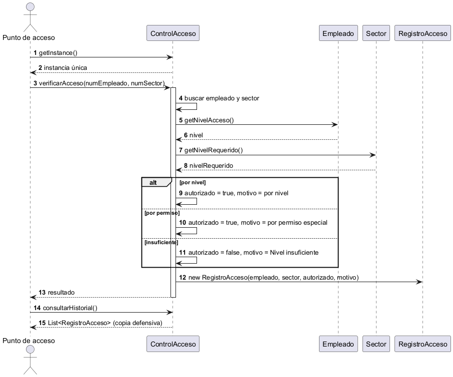

# Patrón Singleton — Sistema de Control de Acceso

### Evaluación Global Integradora (EGI) · Diseño de Software

| Dato | Valor |
|------|-------|
| **Modalidad** | Grupal |
| **Integrantes** | Candito, Yampa <br> Rodriguez, Federico <br> Gilio, Giuliano <br> Marasco, Lucas |
| **Carrera** | Tecnicatura Universitaria en Desarrollo de Software |
| **Espacio curricular** | Diseño de Software — 2.º año, 3.er semestre |
| **Institución** | ITU — Instituto Tecnológico Universitario, Universidad Nacional de Cuyo, Sede Este |
| **Docente** | Lic. Ignacio G. Fontaine Digier |
| **Fecha de entrega** | 30/11/2026 |
| **Versión del documento** | 1.1 |
| **Patrón elegido** | **Singleton** |
| **Lenguaje** | **Java** (versión 23; código compatible con Java 17+) |
| **Repositorio GitHub** | <https://github.com/PatronSingleton-DisenoSoftware/Patron-Singleton-Software-EGI> |

> **Estado de este documento:** informe completo. Las cuatro secciones requeridas
> presentan el análisis del problema, el diseño arquitectónico alineado con el diagrama UML,
> la implementación del código fuente y el análisis crítico de principios SOLID y patrón Singleton.

---

## Índice

- [Sección I. Planteamiento y justificación del problema](#sección-i-planteamiento-y-justificación-del-problema)
- [Sección II. Diseño arquitectónico](#sección-ii-diseño-arquitectónico)
- [Sección III. Implementación práctica](#sección-iii-implementación-práctica)
- [Sección IV. Análisis crítico y principios SOLID](#sección-iv-análisis-crítico-y-principios-solid)
- [Anexo. Decisiones de diseño](#anexo-decisiones-de-diseño)
- [Lista de control de la consigna](#lista-de-control-de-la-consigna)

---

# Sección I. Planteamiento y justificación del problema

## 1.1. Escenario

La empresa **ENVIDIA** administra un edificio con sectores de acceso restringido: oficinas
administrativas, Recursos Humanos, depósitos y una sala de servidores. Cada sector tiene un
punto de acceso físico (lector de credencial) desde el cual un empleado intenta ingresar.

El sistema debe, para cada intento:

1. verificar la identificación del empleado,
2. consultar sus autorizaciones vigentes,
3. decidir si el ingreso se autoriza o se rechaza,
4. dejar un registro del intento, con fecha, hora y motivo.

El escenario es propio de este trabajo: no corresponde a los ejemplos analizados en clase
(envíos marítimos y terrestres para Factory Method).

## 1.2. La solución convencional y sus problemas de diseño

La forma "natural" de resolverlo sin patrones es que **cada punto de acceso construya su
propio gestor** de empleados y permisos: `new GestorAcceso()` en cada puerta. Esa decisión,
que parece inofensiva, produce exactamente los problemas que la consigna pide analizar:

### Acoplamiento fuerte

Cada puerta queda acoplada a una implementación concreta del gestor y a su propio ciclo de
vida. Si mañana el gestor necesita una dependencia (una base de datos, un servicio de
auditoría), hay que modificar **todos** los puntos de construcción. Además, los puntos de
acceso no pueden coordinarse entre sí porque no comparten estado ni conocen al mismo objeto.

### Rigidez ante el cambio

Agregar una regla nueva —por ejemplo, "los permisos vencen a los 30 días"— obliga a
replicar la lógica en cada copia del gestor. Cada cambio se multiplica por la cantidad de
puertas y cualquier olvido genera comportamiento distinto según el sector.

### Duplicación de estado (el problema crítico)

Si Recursos Humanos revoca el permiso de un empleado, la baja se aplica únicamente en la
instancia donde se ejecutó la acción. Las demás puertas siguen trabajando con su copia:

> Un empleado al que se le revocó el acceso puede ingresar por cualquier otra puerta que
> todavía no actualizó sus datos.

No es duplicación de código solamente: es **duplicación de la verdad**. Cada instancia
tiene su propia versión de quién puede entrar y adónde. El control de acceso deja de ser
centralizado y la empresa queda con una vulnerabilidad de seguridad, no con un problema
de estilo.

### Desperdicio de recursos

Cada instancia mantiene su propia lista de empleados, sectores y registros. Con N puertas
hay N copias de la misma información en memoria, y N lugares donde crece el historial sin
control.

### Resumen del contraste

| Aspecto | Sin patrón (N instancias) | Con Singleton (1 instancia) |
|---------|---------------------------|-----------------------------|
| Fuente de verdad | N copias que divergen | Una sola |
| Revocación de permiso | Se aplica en una puerta | Se aplica en todo el edificio |
| Cambio de regla | Se replica en cada copia | Se modifica una vez |
| Uso de memoria | N copias del mismo estado | Una copia compartida |
| Auditoría | Historial fragmentado | Historial único y consultable |

## 1.3. Justificación del patrón elegido

El requisito del dominio no es "crear objetos de una familia" (Factory Method) ni
"notificar cambios a varios interesados" (Observer): es que **exista un único gestor de
seguridad compartido por todo el sistema**. Ese es exactamente el problema que resuelve
Singleton.

Singleton garantiza:

1. **Una única instancia** de `ControlAcceso`, controlada por la propia clase.
2. **Un punto de acceso global** (`getInstance()`) para que cualquier puerta consulte el
   mismo estado sin recibirlo por parámetro.
3. **Coherencia inmediata**: una revocación se ve en todos los sectores en el mismo
   instante, porque no hay copias.

Frente a las alternativas del menú de la consigna:

| Patrón | Por qué no es la mejor opción aquí |
|--------|-------------------------------------|
| Factory Method | Resuelve la creación de objetos de una familia; no impide que existan varios gestores ni garantiza estado compartido. |
| Observer | Resolvería "avisar" a las puertas de un cambio, pero sigue permitiendo múltiples gestores como origen del estado: ataca el síntoma, no la causa. |

El patrón elegido **no se usa como adorno**: sin él, el sistema no puede cumplir su
requisito de seguridad. Esa es la justificación técnica que pide la Sección I.

## 1.4. Alcance

| Dentro del alcance | Fuera del alcance |
|--------------------|-------------------|
| Modelo de dominio: `Empleado`, `Sector`, `Permiso`, `RegistroAcceso` | Persistencia en base de datos |
| `ControlAcceso` como Singleton | Interfaz gráfica (la consigna no la exige) |
| Niveles de acceso acumulativos (1 a 5) | Integración con hardware de lectores |
| Permisos especiales y su revocación | Autenticación biométrica |
| Registro y consulta del historial de intentos | Despliegue en servidores de aplicación |

---

# Sección II. Diseño arquitectónico

## 2.1. Diagrama de clases UML


*Fuente editable del diagrama: [`assets/uml-clases.puml`](assets/uml-clases.puml). Los
miembros `static` aparecen subrayados; la visibilidad (`-` privado, `+` público) se
muestra en cada miembro.*

> Las figuras 1 y 2 están embebidas como imágenes, así que se incluyen al exportar a PDF
> sin depender de que el conversor renderice Mermaid.

## 2.2. Roles del patrón Singleton

La consigna exige respetar estrictamente los roles del patrón y mostrar la visibilidad
(`+` público, `-` privado, `#` protegido).

| Rol del patrón | Elemento en el diseño | Visibilidad |
|----------------|-----------------------|-------------|
| Atributo con la instancia única | `ControlAcceso.instancia` | `- private static` |
| Constructor privado | `ControlAcceso()` | `- private` |
| Método estático de acceso | `ControlAcceso.getInstance()` | `+ public static` |
| Cliente | `Main` (clase de prueba / consola) | `+ public static void main` |

| Elemento | Visibilidad | Motivo |
|----------|-------------|--------|
| `instancia` | `-` | Nadie fuera de la clase puede reemplazar la referencia. |
| Constructor | `-` | Impide `new ControlAcceso()` desde el cliente. |
| `getInstance()` | `+` | Único camino permitido para obtener el objeto. |
| Atributos del dominio (`empleados`, `sectores`, `permisos`, `registros`) | `-` | Encapsulamiento; se accede por métodos públicos. |
| Métodos de gestión | `+` | API que consumen los puntos de acceso. |
| Métodos auxiliares de búsqueda y de permisos | `+` / `-` | `buscarEmpleado`, `buscarEmpleadoPorDni` y `buscarSector` (públicos); `buscarPermiso` y `tienePermisoEspecialActivo` (privados). |

## 2.3. Clases, atributos y responsabilidades

| Clase | Atributos clave | Responsabilidad |
|-------|-----------------|-----------------|
| `ControlAcceso` | `instancia`, `empleados`, `sectores`, `permisos`, `registros`, `mostrarMensajesRegistro` | Fuente única de verdad: altas, niveles, permisos, verificación y consulta. |
| `Empleado` | `idEmpleado`, `dni`, `nombre`, `apellido`, `nivelAcceso`, `registroValido` | Datos del empleado, su nivel y la validez calculada de sus datos. |
| `Sector` | `idSector`, `nombre`, `nivelRequerido` | Área restringida y nivel mínimo para ingresar. |
| `Permiso` | `empleado`, `sector`, `activo`, `especial` | Relación empleado–sector, con baja lógica. |
| `RegistroAcceso` | `empleado`, `sector`, `fechaHora`, `autorizado`, `motivo` | Evidencia del intento, para auditoría. |
| `NivelAcceso` | `NIVEL_1` … `NIVEL_5` | Niveles acumulativos según su valor numérico (`getNivel()`). |

> **Nombres tal como están en el código.** El diagrama y estas tablas usan los
> identificadores reales de `src/` en `main`, incluidos `getInstance()`, `nivelAcceso`,
> `idEmpleado`, `idSector`, `registroValido` y `especial`. Las brechas que aún quedan
> frente a los ADR (`boolean especial` y `verificarAcceso` que registra) están documentadas
> en el [Anexo](#anexo-decisiones-de-diseño) y en
> [`informe/05-implementacion.md`](informe/05-implementacion.md#55-brecha-entre-diseño-e-implementación).
>
> Las clases `ControlAcceso`, `Empleado`, `Sector`, `Permiso` y `RegistroAcceso` se
> declaran `final`: no se heredan y el compilador puede verificar esa restricción
> ([ADR-09](#anexo-decisiones-de-diseño)).

## 2.4. Reglas de negocio del dominio

Las reglas describen el comportamiento que el sistema **debe** cumplir. La columna de
estado indica si el código de `main` ya las implementa.

| ID | Regla | Estado en el código |
|----|-------|---------------------|
| RN-01 | Un empleado con nivel *n* puede ingresar a todo sector cuyo `nivelRequerido` sea `NIVEL_1` … `NIVEL_n`, según el valor numérico del enum. | ✅ Implementado vía `getNivel()` |
| RN-02 | Un permiso con `especial == true` y `activo == true` permite el ingreso aunque el nivel sea insuficiente. | ✅ Implementado en `tienePermisoEspecialActivo()` |
| RN-03 | Un permiso revocado (`activo == false`) no habilita el ingreso y no se elimina. | ✅ Implementado en `revocarPermiso()` y `Permiso.revocar()` |
| RN-04 | Todo intento se registra, sea autorizado o rechazado. | ✅ Implementado en `verificarAcceso()` |
| RN-05 | Todo rechazo registra un `motivo`. | ✅ Implementado con motivos descriptivos |
| RN-06 | La revocación es visible de inmediato en todos los sectores (consecuencia de la instancia única). | ✅ Garantizado por Singleton |
| RN-07 | Solo se concede un permiso a un empleado y un sector existentes. | ✅ Validado en `concederPermiso()` |

## 2.5. Flujo previsto de un intento de ingreso



*Fuente editable del diagrama: [`assets/flujo-acceso.puml`](assets/flujo-acceso.puml).*

---

# Sección III. Implementación práctica

## 3.1. Entorno, versión y ejecución

| Requisito | Valor |
|-----------|-------|
| Lenguaje | Java |
| Versión usada | JDK 23.0.1 (el código no usa APIs posteriores a Java 17) |
| IDE | IntelliJ IDEA Community 2025.2 |
| Estructura de carpetas | `src/` para fuentes, `docs/` para documentación, `out/` para binarios |

### Cómo compilar y ejecutar desde la terminal

```powershell
# Compilar todo src/ y dejar los .class en out/
javac -d out (Get-ChildItem src\*.java).FullName

# Ejecutar la clase principal
java -cp out Main
```

## 3.2. Estructura de archivos

```
src/
├── ControlAcceso.java    ← Singleton: listas, constructor, getInstance(), lógica de negocio e historial
├── Empleado.java         ← 6 atributos (incluye registroValido), validación de DNI y datos, getters, setters y toString()
├── Main.java             ← clase de prueba, menú interactivo y demostración automática
├── Permiso.java          ← 4 atributos, constructor con datos, getters, setters y revocar()
├── RegistroAcceso.java   ← 5 atributos, constructor con LocalDateTime.now(), getters, setters y toString()
├── Sector.java           ← 3 atributos, validación vía setters, getters, setters y toString()
└── NivelAcceso.java      ← enum NIVEL_1 … NIVEL_5
```

## 3.3. Código del Singleton (`ControlAcceso.java`)

```java
import java.util.ArrayList;
import java.util.List;

public final class ControlAcceso {
    // Atributos
    private final List<Empleado> empleados;
    private final List<Sector> sectores;
    private final List<Permiso> permisos;
    private final List<RegistroAcceso> registros;
    private static ControlAcceso instancia;
    private boolean mostrarMensajesRegistro = true;

    // Constructor de acceso unico
    private ControlAcceso() {
        this.empleados = new ArrayList<>();
        this.sectores = new ArrayList<>();
        this.permisos = new ArrayList<>();
        this.registros = new ArrayList<>();
    }

    // Metodo de acceso unico
    public static ControlAcceso getInstance() {
        if (instancia == null) {
            instancia = new ControlAcceso();
        }
        return instancia;
    }

    public void setMostrarMensajesRegistro(boolean mostrar) { /* ... */ }

    public void registrarEmpleado(Empleado empleado) { /* ... */ }
    public void registrarSector(Sector sector) { /* ... */ }
    public void asignarNivel(Empleado empleado, NivelAcceso nivelAcceso) { /* ... */ }
    public void concederPermiso(Permiso permiso) { /* ... */ }
    public void revocarPermiso(Permiso permiso) { /* ... */ }
    public boolean verificarAcceso(int numEmpleado, int numSector) { /* ... */ }

    // Devuelve el historial de intentos
    public List<RegistroAcceso> consultarHistorial() {
        if (this.registros.isEmpty()) {
            System.out.println("El historial esta vacio: no hay intentos de acceso registrados");
            return new ArrayList<>();
        }
        // Se devuelve una copia para que el cliente no modifique la lista interna
        return new ArrayList<>(this.registros);
    }

    // Auxiliares de busqueda y permisos
    public Empleado buscarEmpleado(int idEmpleado) { /* ... */ }
    public Empleado buscarEmpleadoPorDni(int dni) { /* ... */ }
    public Sector buscarSector(int idSector) { /* ... */ }
    private Permiso buscarPermiso(Empleado empleado, Sector sector) { /* ... */ }
    private boolean tienePermisoEspecialActivo(Empleado empleado, Sector sector) { /* ... */ }
}
```

| Elemento | Por qué |
|----------|---------|
| `private static ControlAcceso instancia;` | `static`: un solo casillero para toda la clase. `private`: nadie de afuera lo reemplaza. |
| `private ControlAcceso()` | `new ControlAcceso()` no compila fuera de la clase. Además inicializa las cuatro listas. |
| `public static ... getInstance()` | Único camino de acceso; crea la instancia la primera vez. |
| `if (instancia == null)` | Inicialización perezosa (*lazy*). |
| `private final List<...>` | La referencia a cada colección no se reemplaza después del constructor. |
| `mostrarMensajesRegistro` | Permite silenciar los avisos de la carga inicial y reactivarlos para el menú. |
| Métodos de gestión | Implementan validaciones completas, jerarquías de nivel y revocación. |
| `verificarAcceso(int, int)` y `consultarHistorial()` | Validan permisos, registran intentos de acceso y retornan copia defensiva de la colección (`List<RegistroAcceso>`). |

## 3.4. Clase de prueba (`Main`)

`Main.java` contiene el punto de entrada interactivo que utiliza el Singleton `ControlAcceso` para dar de alta empleados, validar entradas por consola y alimentar el estado centralizado del sistema.

Para verificar que dos llamadas devuelven exactamente la misma referencia en memoria:

```java
ControlAcceso puertaPrincipal = ControlAcceso.getInstance();
ControlAcceso salaServidores = ControlAcceso.getInstance();

System.out.println("Puerta principal: " + puertaPrincipal);
System.out.println("Sala de servidores: " + salaServidores);
System.out.println("¿Misma instancia? " + (puertaPrincipal == salaServidores));
```

Salida esperada:

```
Puerta principal: ControlAcceso@1b6d3586
Sala de servidores: ControlAcceso@1b6d3586
¿Misma instancia? true
```

### Flujo completo demostrado por el sistema

1. Obtener el gestor desde dos "puertas" distintas y comprobar que es el mismo objeto.
2. Registrar un sector (`Sala de servidores`, nivel `NIVEL_4`) y dos empleados.
3. Un empleado `NIVEL_2` intenta entrar → **rechazado** con motivo.
4. Se le concede un permiso con `especial = true` → vuelve a intentar → **autorizado**.
5. Se revoca el permiso → intenta de nuevo → **rechazado**.
6. Se consulta el historial: 3 registros con fecha/hora y resultado.

Ese recorrido demuestra las dos caras del patrón: una sola instancia y un estado
compartido que cambia para todos los puntos de acceso. El gestor implementa la lógica
de `verificarAcceso(int, int)`, el registro de cada intento y `consultarHistorial()`
devolviendo la colección de registros (`List<RegistroAcceso>`) como copia defensiva.

La demostración automática (opción 9 del menú) es **idempotente**: antes de dar de alta
sus sectores y empleados de prueba consulta si ya existen, de modo que puede ejecutarse
varias veces sobre la misma instancia sin duplicar datos ni imprimir avisos de "ya existe".
La carga inicial de `main()` silencia los mensajes de registro con
`setMostrarMensajesRegistro(false)` y los reactiva antes de mostrar el menú.

El menú también incluye la opción 10, que permite reasignar el nivel de un empleado ya
registrado mediante `asignarNivel(empleado, nivel)`. El cambio se refleja de inmediato en
la siguiente verificación de acceso, porque el estado es único.

## 3.5. Estado del código frente a la consigna

| Requisito de la Sección III | Estado |
|-----------------------------|--------|
| Código completo, sin partes por completar | ✅ Las entidades y la lógica de ControlAcceso están implementadas |
| Restricciones del patrón (constructor privado, atributo estático privado, acceso estático público) | ✅ Implementadas |
| Clase de prueba con flujo simulado | ✅ Main interactivo con demostración automática conectada al Singleton |
| Versión del lenguaje indicada | ✅ Java 23 (compatible 17+) |
| Cómo se ejecuta | ✅ Comandos en §3.1 |
| Compilación sin advertencias | ✅ `javac -Xlint:all` sin advertencias |
| Enlace al GitHub personal | ✅ Repositorio público en §3.6 |

## 3.6. Enlace al repositorio

**Repositorio:** <https://github.com/PatronSingleton-DisenoSoftware/Patron-Singleton-Software-EGI>

El repositorio contiene `src/` con el código, `docs/` con este documento y las
instrucciones de ejecución en `docs/manual/`.

---

# Sección IV. Análisis crítico y principios SOLID

## 4.1. Relación con SOLID

La consigna pide conectar la teoría con el propio código, indicando beneficios y
tensiones. El análisis se hace sobre `ControlAcceso`, que es donde el patrón concentra
decisiones.

### S — Responsabilidad Única (tensión principal)

`ControlAcceso` acumula, como mínimo, estas responsabilidades:

1. garantizar la instancia única (`instancia`, `getInstance()`);
2. administrar empleados (`registrarEmpleado`);
3. administrar sectores (`registrarSector`);
4. administrar permisos (`concederPermiso`, `revocarPermiso`);
5. asignar niveles (`asignarNivel`);
6. decidir autorizaciones y exponer el historial (`verificarAcceso(int, int)`,
   `consultarHistorial()`).

Son **seis motivos para cambiar** la misma clase: si cambia la política de permisos, si se
agrega persistencia, si se modifica el formato del historial. El patrón, por su propia
naturaleza de "punto único", empuja en dirección contraria a SRP. La consigna lo señala
explícitamente como el punto de partida para SOLID.

**Mitigación aplicada:** `consultarHistorial()` devuelve una copia defensiva (`new ArrayList<>(this.registros)`)
para proteger el encapsulamiento del historial. `verificarAcceso` gestiona internamente la creación del registro.

**Mitigación posible a futuro:** extraer `RepositorioEmpleados`, `RepositorioSectores`,
`ServicioPermisos` y `ServicioRegistros`, y dejar a `ControlAcceso` como fachada. Se evita
hoy porque el alcance de la EGI no lo exige y agregaría clases sin necesidad demostrada.

### O — Abierto/Cerrado (tensión)

- **Beneficio parcial:** agregar un sector nuevo (Depósito, nivel `NIVEL_2`) o un empleado
  nuevo **no requiere tocar código**: es un dato. Los niveles viven en el enum
  `NivelAcceso` y los sectores en la colección `sectores`.
- **Tensión:** agregar una **regla** nueva (por ejemplo, "no se permite ingresar entre las
  23 y las 6") obliga a modificar `verificarAcceso()`. La clase no está cerrada a
  modificación en su dimensión de comportamiento.

**Alternativa:** modelar las reglas como estrategias (`ReglaAcceso` con implementaciones
`ReglaNivel`, `ReglaHorario`) y que `verificarAcceso()` recorra una lista. Sería la
solución "abierta/cerrada"; se documenta como mejora, no se implementa en esta entrega.

### L — Sustitución de Liskov (sin conflicto)

El diseño no usa jerarquías de herencia: `Empleado`, `Sector`, `Permiso` y
`RegistroAcceso` son clases independientes; `NivelAcceso` es un enum y `TipoPermiso` no
existe en el código. Además, las cinco clases del dominio se declaran `final`, de modo
que ni siquiera por herencia se puede alterar su contrato. No hay subtipos que puedan
romper el contrato de un supertipo, por lo que LSP no se ve comprometido. Es una
consecuencia de haber preferido **composición** (un `Permiso` referencia a un `Empleado`
y a un `Sector`) sobre herencia.

### I — Segregación de Interfaces

Hoy no hay interfaces, así que el principio no se viola ni se aprovecha. Si se introdujera
una interfaz `GestorAcceso` con los ocho métodos públicos, cualquier cliente que solo
necesite consultar el historial se vería obligado a depender de métodos que no usa
(acoplamiento innecesario). La versión correcta sería segregarla:

- `ConsultorAcceso` → `verificarAcceso`, `consultarHistorial`
- `AdministradorAcceso` → altas, niveles, permisos

### D — Inversión de Dependencias (tensión para testing)

`Main` y los puntos de acceso llaman a `ControlAcceso.getInstance()`: dependen de una
**clase concreta** y de un método estático. No hay forma de sustituir el gestor por un
doble de prueba sin tocar el código. Esto es la raíz de la "dificultad de testing" que la
consigna pide analizar.

**Mejora:** definir una interfaz `GestorAcceso`, hacer que `ControlAcceso` la implemente y
que los clientes reciban la dependencia por constructor (inyección). El Singleton quedaría
como **una** implementación posible, no como la única forma de obtener el colaborador.

## 4.2. Ventajas técnicas del diseño

| Ventaja | Dónde se ve en el código |
|---------|--------------------------|
| **Fuente única de verdad** | `instancia` + las cuatro colecciones en `ControlAcceso`. |
| **Desacoplamiento entre puntos de acceso** | Las puertas no se conocen entre sí; solo llaman a `getInstance()`. |
| **Coherencia inmediata** | `revocarPermiso()` modifica el único estado y el próximo `verificarAcceso()` de cualquier puerta lo refleja de inmediato. |
| **Eficiencia de recursos** | Una sola copia de empleados, sectores, permisos y registros en memoria. |
| **Auditoría centralizada** | `consultarHistorial()` apunta a una única colección de registros, no a historiales fragmentados. |
| **Extensibilidad de datos** | Agregar sectores o empleados no requiere recompilar lógica nueva. |

## 4.3. Desventajas y riesgos

| Riesgo | Explicación | Mitigación |
|--------|-------------|------------|
| **Estado global** | Cualquier clase puede obtener el gestor y modificar el sistema; las dependencias quedan ocultas en el código. | Inyectar el gestor en lugar de llamar a `getInstance()` dentro de la lógica. |
| **Problemas en entornos multihilo** | Dos hilos que evalúen `instancia == null` a la vez pueden crear dos instancias. Además, las colecciones (`ArrayList`) no son seguras para escritura concurrente. | `synchronized`, inicialización anticipada, holder idiom o `enum`; colecciones concurrentes. |
| **Dificultades de testing** | El estado persiste entre pruebas y no se puede sustituir por un mock. | Interfaz + inyección; método de reinicio visible solo en el paquete de pruebas. |
| **Tensión con SRP** | La clase central acumula creación, altas, niveles, permisos, verificación y consulta del historial. | Extraer servicios y dejar una fachada. |
| **Fugas de memoria** | La referencia `static` mantiene viva la instancia durante toda la vida del `ClassLoader`; en servidores de aplicación, un redeploy puede dejar el objeto anterior retenido. En escritorio el impacto es bajo. | Evitar estado estático en aplicaciones con recarga de clases; cerrar y liberar recursos. |
| **Crecimiento sin límite del historial** | `registros` crece con cada intento de acceso y no tiene purga. | Política de retención o persistencia con rotación. |
| **Serialización y reflexión** | Pueden crear una segunda instancia si no se protege (`readResolve`) o si el constructor privado se fuerza por reflexión. | Usar `enum` como implementación más robusta. |

## 4.4. Autoevaluación

La estructura del patrón resuelve el problema que el escenario planteaba: con una sola
instancia, la revocación de un permiso no puede quedar "en una puerta". Esa es la ganancia
concreta demostrada por el código del Singleton.

El costo también es concreto: `ControlAcceso` es la clase con más motivos para cambiar del
sistema, el testing es más difícil de lo que sería con dependencias inyectadas y la
implementación actual no es segura frente a hilos. Ninguno de esos costos invalida la
elección del patrón, pero **un informe que los omitiera sería incompleto**: la consigna
evalúa justamente el criterio para reconocerlos.

La deuda técnica queda registrada en el [Anexo](#anexo-decisiones-de-diseño) (ADR-02, ADR-06 y ADR-07).

---

# Anexo. Decisiones de diseño

Decisiones tomadas antes de programar, con el estado real de aplicación en el código de
`main`. El detalle extendido está en `docs/informe/09-decisiones.md`.

| ADR | Decisión | Motivo | Estado en el código |
|-----|----------|--------|---------------------|
| ADR-01 | `NivelAcceso` como enum con valor numérico | Evita niveles inválidos y centraliza la comparación acumulativa. | ✅ Aplicado: enum con `NIVEL_1`…`NIVEL_5` y `alcanzaA()` por `getNivel()`. |
| ADR-02 | `TipoPermiso` como enum | El atributo `tipo` no tenía tipo definido. | ❌ No aplicado: se usa `boolean especial`; `TipoPermiso.java` no existe. |
| ADR-03 | `fechaHora` como `LocalDateTime` | Permite ordenar y filtrar el historial sin parsear texto. | ✅ Aplicado: asignado automáticamente en constructor con `LocalDateTime.now()`. |
| ADR-04 | `idEmpleado` / `idSector` en lugar de `idS` | Nombres explícitos por entidad y consistentes con la convención. | ✅ Aplicado: atributos, getters y setters renombrados. |
| ADR-05 | La colección `permisos` vive en `ControlAcceso` | Sin ella, conceder y revocar no tendrían un único lugar donde persistir. | ✅ Aplicado: `private List<Permiso> permisos`. |
| ADR-06 | `verificarAcceso()` no registra; `registrarIntento()` sí | Separa consulta de efecto secundario. | ❌ No aplicado: `verificarAcceso(int, int)` evalúa y registra; `consultarHistorial()` devuelve copia. |
| ADR-07 | Singleton lazy sin `synchronized` | Claridad didáctica; el riesgo multihilo se documenta en §4.3. | ✅ Aplicado: `getInstance()` crea la instancia en la primera llamada. |
| ADR-08 | Setters en todas las clases | Cumple la regla de la cátedra, aun cuando `RegistroAcceso` podría ser inmutable. | ✅ Aplicado: constructores, getters y setters en todas las clases; copia defensiva en historial. |
| ADR-09 | Clases de dominio `final` y validez calculada | Evita herencia no prevista y advertencias `this-escape`; la validez se recalcula desde los datos. | ✅ Aplicado: `final` en las cinco clases; `Empleado.datosValidos()` y `setRegistroValido()` no permiten forzar un estado inválido. |

---

# Lista de control de la consigna

| # | Ítem de la lista de control | Estado |
|---|-----------------------------|--------|
| 1 | El documento indica el patrón y el lenguaje elegidos | ✅ Singleton · Java |
| 2 | El escenario es un problema de negocio real, distinto de los vistos en clase | ✅ ENVIDIA / control de acceso |
| 3 | La Sección I justifica el patrón frente a una solución sin patrones | ✅ §1.2 y §1.3 |
| 4 | El diagrama UML respeta los roles del patrón y muestra visibilidad | ✅ §2.1 (imagen embebida) y §2.2 |
| 5 | El código está completo, se ejecuta tal como se entrega y respeta el patrón | ✅ Código completo y ejecutable |
| 6 | El programa tiene su propia clase de prueba con flujo simulado | ✅ Main interactivo conectado al Singleton |
| 7 | El código está en GitHub con acceso para el docente y el enlace figura en la Sección III | ✅ Repositorio público en §3.6 |
| 8 | La Sección IV analiza SOLID y ventajas/desventajas con referencias al código | ✅ §4.1 a §4.4 |
| 9 | Todo está en un único documento con las cuatro secciones en orden | ✅ este documento |

## Qué falta para poder entregar

1. Exportar este documento a PDF y subirlo al campus virtual.
