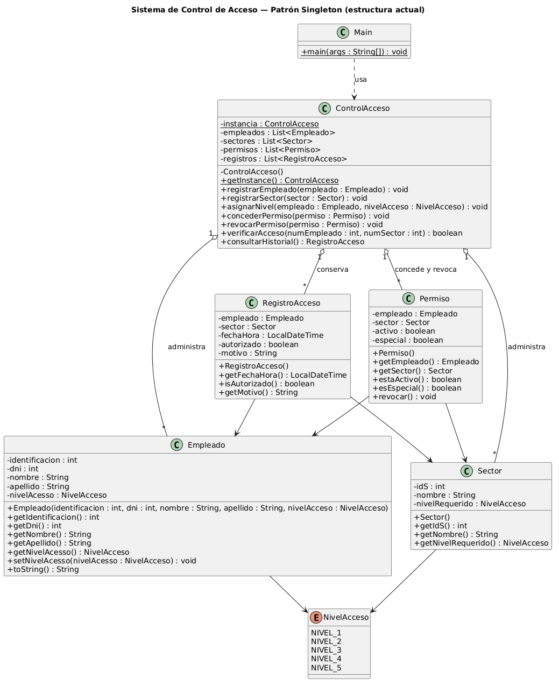
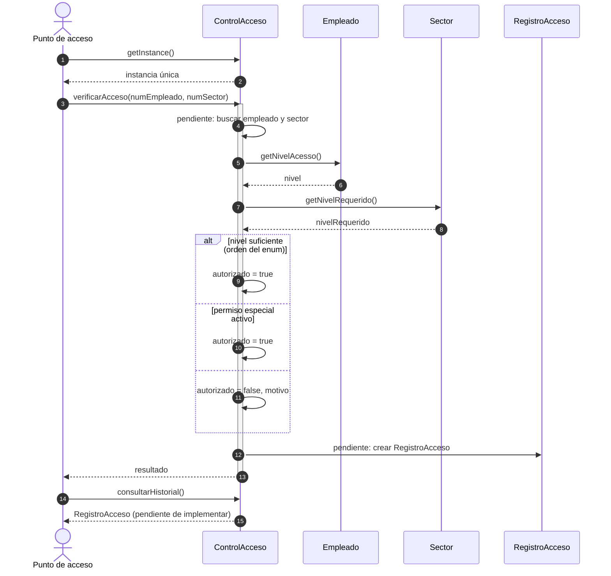

# Patrón Singleton — Sistema de Control de Acceso

### Evaluación Global Integradora (EGI) · Diseño de Software

| Dato | Valor |
|------|-------|
| **Modalidad** | Grupal |
| **Integrantes** | [Completar nombre y apellido — Legajo] <br> [Completar nombre y apellido — Legajo] |
| **Carrera** | Tecnicatura Universitaria en Desarrollo de Software |
| **Espacio curricular** | Diseño de Software — 2.º año, 3.er semestre |
| **Institución** | ITU — Instituto Tecnológico Universitario, Universidad Nacional de Cuyo, Sede Este |
| **Docente** | Lic. Ignacio G. Fontaine Digier |
| **Fecha de entrega** | [Completar] |
| **Patrón elegido** | **Singleton** |
| **Lenguaje** | **Java** (versión 23; código compatible con Java 17+) |
| **Repositorio GitHub** | [Completar enlace público con acceso para el docente] |

> **Estado de este documento:** borrador avanzado. Las Secciones I, II y IV están
> completas; la Sección III describe **el código que existe hoy en `main`**, que ya tiene
> la estructura de las siete clases y del Singleton, pero **todavía no implementa la
> lógica de negocio** ni el flujo de demostración. El detalle bloqueante está en la
> [lista de control](#lista-de-control-de-la-consigna).

---

## Índice

- [Sección I. Planteamiento y justificación del problema](#sección-i-planteamiento-y-justificación-del-problema)
- [Sección II. Diseño arquitectónico](#sección-ii-diseño-arquitectónico)
- [Sección III. Implementación práctica](#sección-iii-implementación-práctica)
- [Sección IV. Análisis crítico y principios SOLID](#sección-iv-análisis-crítico-y-principios-solid)
- [Anexo. Decisiones de diseño](#anexo-decisiones-de-diseño)
- [Lista de control de la consigna](#lista-de-control-de-la-consigna)

---

# Sección I. Planteamiento y justificación del problema

## 1.1. Escenario

La empresa **ENVIDIA** administra un edificio con sectores de acceso restringido: oficinas
administrativas, Recursos Humanos, depósitos y una sala de servidores. Cada sector tiene un
punto de acceso físico (lector de credencial) desde el cual un empleado intenta ingresar.

El sistema debe, para cada intento:

1. verificar la identificación del empleado,
2. consultar sus autorizaciones vigentes,
3. decidir si el ingreso se autoriza o se rechaza,
4. dejar un registro del intento, con fecha, hora y motivo.

El escenario es propio de este trabajo: no corresponde a los ejemplos analizados en clase
(envíos marítimos y terrestres para Factory Method).

## 1.2. La solución convencional y sus problemas de diseño

La forma "natural" de resolverlo sin patrones es que **cada punto de acceso construya su
propio gestor** de empleados y permisos: `new GestorAcceso()` en cada puerta. Esa decisión,
que parece inofensiva, produce exactamente los problemas que la consigna pide analizar:

### Acoplamiento fuerte

Cada puerta queda acoplada a una implementación concreta del gestor y a su propio ciclo de
vida. Si mañana el gestor necesita una dependencia (una base de datos, un servicio de
auditoría), hay que modificar **todos** los puntos de construcción. Además, los puntos de
acceso no pueden coordinarse entre sí porque no comparten estado ni conocen al mismo objeto.

### Rigidez ante el cambio

Agregar una regla nueva —por ejemplo, "los permisos vencen a los 30 días"— obliga a
replicar la lógica en cada copia del gestor. Cada cambio se multiplica por la cantidad de
puertas y cualquier olvido genera comportamiento distinto según el sector.

### Duplicación de estado (el problema crítico)

Si Recursos Humanos revoca el permiso de un empleado, la baja se aplica únicamente en la
instancia donde se ejecutó la acción. Las demás puertas siguen trabajando con su copia:

> Un empleado al que se le revocó el acceso puede ingresar por cualquier otra puerta que
> todavía no actualizó sus datos.

No es duplicación de código solamente: es **duplicación de la verdad**. Cada instancia
tiene su propia versión de quién puede entrar y adónde. El control de acceso deja de ser
centralizado y la empresa queda con una vulnerabilidad de seguridad, no con un problema
de estilo.

### Desperdicio de recursos

Cada instancia mantiene su propia lista de empleados, sectores y registros. Con N puertas
hay N copias de la misma información en memoria, y N lugares donde crece el historial sin
control.

### Resumen del contraste

| Aspecto | Sin patrón (N instancias) | Con Singleton (1 instancia) |
|---------|---------------------------|-----------------------------|
| Fuente de verdad | N copias que divergen | Una sola |
| Revocación de permiso | Se aplica en una puerta | Se aplica en todo el edificio |
| Cambio de regla | Se replica en cada copia | Se modifica una vez |
| Uso de memoria | N copias del mismo estado | Una copia compartida |
| Auditoría | Historial fragmentado | Historial único y consultable |

## 1.3. Justificación del patrón elegido

El requisito del dominio no es "crear objetos de una familia" (Factory Method) ni
"notificar cambios a varios interesados" (Observer): es que **exista un único gestor de
seguridad compartido por todo el sistema**. Ese es exactamente el problema que resuelve
Singleton.

Singleton garantiza:

1. **Una única instancia** de `ControlAcceso`, controlada por la propia clase.
2. **Un punto de acceso global** (`getInstance()`) para que cualquier puerta consulte el
   mismo estado sin recibirlo por parámetro.
3. **Coherencia inmediata**: una revocación se ve en todos los sectores en el mismo
   instante, porque no hay copias.

Frente a las alternativas del menú de la consigna:

| Patrón | Por qué no es la mejor opción aquí |
|--------|-------------------------------------|
| Factory Method | Resuelve la creación de objetos de una familia; no impide que existan varios gestores ni garantiza estado compartido. |
| Observer | Resolvería "avisar" a las puertas de un cambio, pero sigue permitiendo múltiples gestores como origen del estado: ataca el síntoma, no la causa. |

El patrón elegido **no se usa como adorno**: sin él, el sistema no puede cumplir su
requisito de seguridad. Esa es la justificación técnica que pide la Sección I.

## 1.4. Alcance

| Dentro del alcance | Fuera del alcance |
|--------------------|-------------------|
| Modelo de dominio: `Empleado`, `Sector`, `Permiso`, `RegistroAcceso` | Persistencia en base de datos |
| `ControlAcceso` como Singleton | Interfaz gráfica (la consigna no la exige) |
| Niveles de acceso acumulativos (1 a 5) | Integración con hardware de lectores |
| Permisos especiales y su revocación | Autenticación biométrica |
| Registro y consulta del historial de intentos | Despliegue en servidores de aplicación |

---

# Sección II. Diseño arquitectónico

## 2.1. Diagrama de clases UML



*Fuente editable del diagrama: [`assets/uml-clases.puml`](assets/uml-clases.puml). Los
miembros `static` aparecen subrayados; la visibilidad (`-` privado, `+` público) se
muestra en cada miembro.*

> La imagen está embebida en este documento, así que se incluye al exportar a PDF sin
> depender de que el conversor renderice Mermaid.

## 2.2. Roles del patrón Singleton

La consigna exige respetar estrictamente los roles del patrón y mostrar la visibilidad
(`+` público, `-` privado, `#` protegido).

| Rol del patrón | Elemento en el diseño | Visibilidad |
|----------------|-----------------------|-------------|
| Atributo con la instancia única | `ControlAcceso.instancia` | `- private static` |
| Constructor privado | `ControlAcceso()` | `- private` |
| Método estático de acceso | `ControlAcceso.getInstance()` | `+ public static` |
| Cliente | `Main` (clase de prueba) | `+ public static void main` |

| Elemento | Visibilidad | Motivo |
|----------|-------------|--------|
| `instancia` | `-` | Nadie fuera de la clase puede reemplazar la referencia. |
| Constructor | `-` | Impide `new ControlAcceso()` desde el cliente. |
| `getInstance()` | `+` | Único camino permitido para obtener el objeto. |
| Atributos del dominio (`empleados`, `sectores`, `permisos`, `registros`) | `-` | Encapsulamiento; se accede por métodos públicos. |
| Métodos de gestión | `+` | API que consumen los puntos de acceso. |
| Métodos auxiliares de búsqueda y de permisos | `-` | **Pendientes**: todavía no existen en el código. |

## 2.3. Clases, atributos y responsabilidades

| Clase | Atributos clave | Responsabilidad |
|-------|-----------------|-----------------|
| `ControlAcceso` | `instancia`, `empleados`, `sectores`, `permisos`, `registros` | Fuente única de verdad: altas, niveles, permisos, verificación y consulta. |
| `Empleado` | `identificacion`, `dni`, `nombre`, `apellido`, `nivelAcesso` | Datos del empleado y su nivel. |
| `Sector` | `idS`, `nombre`, `nivelRequerido` | Área restringida y nivel mínimo para ingresar. |
| `Permiso` | `empleado`, `sector`, `activo`, `especial` | Relación empleado–sector, con baja lógica. |
| `RegistroAcceso` | `empleado`, `sector`, `fechaHora`, `autorizado`, `motivo` | Evidencia del intento, para auditoría. |
| `NivelAcceso` | `NIVEL_1` … `NIVEL_5` | Niveles acumulativos, en el orden en que se declaran. |
| `TipoPermiso` | — | **No existe en el código**: el tipo de permiso se representa con el `boolean especial`. |

> **Nombres tal como están en el código.** El diagrama y estas tablas usan los
> identificadores reales de `src/` en `main`, incluidos `getInstance()`, `nivelAcesso`
> (sin la segunda «c»), `idS` y `especial`. Varios de ellos se apartan de las decisiones
> que se habían registrado como ADR; la brecha está documentada en el
> [Anexo](#anexo-decisiones-de-diseño) y en [`informe/05-implementacion.md`](informe/05-implementacion.md#55-brecha-entre-diseño-e-implementación).

## 2.4. Reglas de negocio del dominio

Las reglas describen el comportamiento que el sistema **debe** cumplir. La columna de
estado indica si el código de `main` ya las implementa.

| ID | Regla | Estado en el código |
|----|-------|---------------------|
| RN-01 | Un empleado con nivel *n* puede ingresar a todo sector cuyo `nivelRequerido` sea `NIVEL_1` … `NIVEL_n`, según el orden de declaración del enum. | ❌ `verificarAcceso()` devuelve `false` fijo |
| RN-02 | Un permiso con `especial == true` y `activo == true` permite el ingreso aunque el nivel sea insuficiente. | ❌ Sin lógica de permisos |
| RN-03 | Un permiso revocado (`activo == false`) no habilita el ingreso y no se elimina. | ❌ `revocar()` está vacío |
| RN-04 | Todo intento se registra, sea autorizado o rechazado. | ❌ No hay método de registro |
| RN-05 | Todo rechazo registra un `motivo`. | ❌ No hay método de registro |
| RN-06 | La revocación es visible de inmediato en todos los sectores (consecuencia de la instancia única). | ✅ La instancia única existe; falta la operación |
| RN-07 | Solo se concede un permiso a un empleado y un sector existentes. | ❌ Sin lógica de permisos |

## 2.5. Flujo previsto de un intento de ingreso

> El flujo completo **todavía no está implementado**: `Main` está vacío y
> `verificarAcceso()` devuelve `false` fijo. El diagrama muestra las llamadas con las
> firmas reales y marca como `pendiente` los pasos que faltan.



---

# Sección III. Implementación práctica

## 3.1. Entorno, versión y ejecución

| Requisito | Valor |
|-----------|-------|
| Lenguaje | Java |
| Versión usada | JDK 23.0.1 (el código no usa APIs posteriores a Java 17) |
| IDE | IntelliJ IDEA Community 2025.2 |
| Build | `javac` (sin Maven ni Gradle) |
| Dependencias | Ninguna |

```powershell
# compilar
javac -d out (Get-ChildItem src\*.java).FullName

# ejecutar
java -cp out Main
```

En IntelliJ: abrir `src/Main.java` y usar **Run** (`Ctrl+Shift+F10`).

## 3.2. Estructura del programa

```
src/
├── ControlAcceso.java    ← Singleton: estructura y firmas, lógica pendiente
├── Empleado.java         ← 5 atributos, constructor, getters, setters y toString()
├── Sector.java           ← 3 atributos y getters (sin setters)
├── Permiso.java          ← 4 atributos, getters, esEspecial() y revocar() vacío
├── RegistroAcceso.java   ← 5 atributos y 3 getters (sin asignar fechaHora)
├── NivelAcceso.java      ← enum NIVEL_1 … NIVEL_5
└── Main.java             ← clase de prueba, todavía vacía
```

`TipoPermiso.java` **no existe**: el carácter especial del permiso se guarda en el
`boolean especial` de `Permiso`.

## 3.3. El Singleton: `ControlAcceso`

Código actual de la pieza central (restringe la creación de la instancia, como exige la
consigna):

```java
import java.util.ArrayList;
import java.util.List;

public class ControlAcceso {
    // Atributos
    private List<Empleado> empleados;
    private List<Sector> sectores;
    private List<Permiso> permisos;
    private List<RegistroAcceso> registros;
    private static ControlAcceso instancia;

    // Constructor de acceso unico
    private ControlAcceso() {
        this.empleados = new ArrayList<>();
        this.sectores = new ArrayList<>();
        this.permisos = new ArrayList<>();
        this.registros = new ArrayList<>();
    }

    // Metodo de acceso unico
    public static ControlAcceso getInstance() {
        if (instancia == null) {
            instancia = new ControlAcceso();
        }
        return instancia;
    }

    // Metodos publicos (logica pendiente)
    public void registrarEmpleado(Empleado empleado) { /* Logica */ }
    public void registrarSector(Sector sector) { /* Logica */ }
    public void asignarNivel(Empleado empleado, NivelAcceso nivelAcceso) { /* Logica */ }
    public void concederPermiso(Permiso permiso) { /* Logica */ }
    public void revocarPermiso(Permiso permiso) { /* Logica */ }

    public boolean verificarAcceso(int numEmpleado, int numSector) {
        boolean ejemplo = false;
        return ejemplo;
    }

    public RegistroAcceso consultarHistorial() {
        return null;
    }
}
```

| Elemento | Por qué |
|----------|---------|
| `private static ControlAcceso instancia;` | `static`: un solo casillero para toda la clase. `private`: nadie de afuera lo reemplaza. |
| `private ControlAcceso()` | `new ControlAcceso()` no compila fuera de la clase. Además inicializa las cuatro listas. |
| `public static ... getInstance()` | Único camino de acceso; crea la instancia la primera vez. |
| `if (instancia == null)` | Inicialización perezosa (*lazy*). |
| Métodos con `/* Logica */` | Firmas definidas; el cuerpo es un marcador de posición, no una implementación. |
| `verificarAcceso(int, int)` y `consultarHistorial()` | Devuelven valores fijos para que el proyecto compile; todavía no consultan las listas. |

## 3.4. Clase de prueba (`Main`)

La consigna exige una clase de prueba propia que **demuestre el comportamiento del patrón**
con un flujo simulado. Hoy `Main` está vacío:

```java
public class Main {
    public static void main(String[] args) {

    }
}
```

La siguiente es la **versión mínima propuesta**, que compila con el código actual y prueba
que dos llamadas devuelven la misma instancia. Todavía no está incorporada al repositorio:

```java
public class Main {
    public static void main(String[] args) {
        ControlAcceso puertaPrincipal = ControlAcceso.getInstance();
        ControlAcceso salaServidores = ControlAcceso.getInstance();

        System.out.println("Puerta principal: " + puertaPrincipal);
        System.out.println("Sala de servidores: " + salaServidores);
        System.out.println("¿Misma instancia? " + (puertaPrincipal == salaServidores));
    }
}
```

Salida esperada (la dirección puede variar):

```
Puerta principal: ControlAcceso@1b6d3586
Sala de servidores: ControlAcceso@1b6d3586
¿Misma instancia? true
```

### Flujo completo que debe demostrar la versión final

1. Obtener el gestor desde dos "puertas" distintas y comprobar que es el mismo objeto.
2. Registrar un sector (`Sala de servidores`, nivel `NIVEL_4`) y dos empleados.
3. Un empleado `NIVEL_2` intenta entrar → **rechazado** con motivo.
4. Se le concede un permiso con `especial = true` → vuelve a intentar → **autorizado**.
5. Se revoca el permiso → intenta de nuevo → **rechazado**.
6. Se consulta el historial: 3 registros con fecha/hora y resultado.

Ese recorrido demuestra las dos caras del patrón: una sola instancia y un estado
compartido que cambia para todos los puntos de acceso. Para que funcione faltan, como
mínimo: la lógica de `verificarAcceso(int, int)`, un método que registre el intento y que
`consultarHistorial()` devuelva la colección de registros.

## 3.5. Estado del código frente a la consigna

| Requisito de la Sección III | Estado |
|-----------------------------|--------|
| Código completo, sin partes por completar | ❌ Las siete clases existen, pero la lógica de `ControlAcceso` y los métodos de `Permiso` están sin implementar |
| Restricciones del patrón (constructor privado, atributo estático privado, acceso estático público) | ✅ Implementadas |
| Clase de prueba con flujo simulado | ❌ `Main` está vacío; la versión mínima está propuesta en §3.4 |
| Versión del lenguaje indicada | ✅ Java 23 (compatible 17+) |
| Cómo se ejecuta | ✅ Comandos en §3.1 |
| Enlace al GitHub personal | ✅ Repositorio público en §3.6 |

## 3.6. Enlace al repositorio

**Repositorio:** <https://github.com/PatronSingleton-DisenoSoftware/Patron-Singleton-Software-EGI>

El repositorio contiene `src/` con el código, `docs/` con este documento y las
instrucciones de ejecución en `docs/manual/`.

---

# Sección IV. Análisis crítico y principios SOLID

## 4.1. Relación con SOLID

La consigna pide conectar la teoría con el propio código, indicando beneficios y
tensiones. El análisis se hace sobre `ControlAcceso`, que es donde el patrón concentra
decisiones.

### S — Responsabilidad Única (tensión principal)

`ControlAcceso` acumula, como mínimo, estas responsabilidades:

1. garantizar la instancia única (`instancia`, `getInstance()`);
2. administrar empleados (`registrarEmpleado`);
3. administrar sectores (`registrarSector`);
4. administrar permisos (`concederPermiso`, `revocarPermiso`);
5. asignar niveles (`asignarNivel`);
6. decidir autorizaciones y exponer el historial (`verificarAcceso(int, int)`,
   `consultarHistorial()`).

Son **seis motivos para cambiar** la misma clase: si cambia la política de permisos, si se
agrega persistencia, si se modifica el formato del historial. El patrón, por su propia
naturaleza de "punto único", empuja en dirección contraria a SRP. La consigna lo señala
explícitamente como el punto de partida para SOLID, y las firmas del código lo confirman
aunque sus cuerpos todavía estén sin implementar.

**Mitigación aplicada:** ninguna todavía. El diseño había previsto separar la consulta del
efecto secundario (`verificarAcceso()` sin registrar y un `registrarIntento()` aparte),
pero el código actual solo declara `verificarAcceso()` y `consultarHistorial()`; no existe
el método que registra. Es una de las brechas del [Anexo](#anexo-decisiones-de-diseño).

**Mitigación posible a futuro:** extraer `RepositorioEmpleados`, `RepositorioSectores`,
`ServicioPermisos` y `ServicioRegistros`, y dejar a `ControlAcceso` como fachada. Se evita
hoy porque el alcance de la EGI no lo exige y agregaría clases sin necesidad demostrada.

### O — Abierto/Cerrado (tensión)

- **Beneficio parcial:** agregar un sector nuevo (Depósito, nivel `NIVEL_2`) o un empleado
  nuevo **no requiere tocar código**: es un dato. Los niveles viven en el enum
  `NivelAcceso` y los sectores en la colección `sectores`.
- **Tensión:** agregar una **regla** nueva (por ejemplo, "no se permite ingresar entre las
  23 y las 6") obliga a modificar `verificarAcceso()`. La clase no está cerrada a
  modificación en su dimensión de comportamiento.

**Alternativa:** modelar las reglas como estrategias (`ReglaAcceso` con implementaciones
`ReglaNivel`, `ReglaHorario`) y que `verificarAcceso()` recorra una lista. Sería la
solución "abierta/cerrada"; se documenta como mejora, no se implementa en esta entrega.

### L — Sustitución de Liskov (sin conflicto)

El diseño no usa jerarquías de herencia: `Empleado`, `Sector`, `Permiso` y
`RegistroAcceso` son clases independientes; `NivelAcceso` es un enum y `TipoPermiso` no
existe en el código. No hay subtipos que puedan romper el contrato de un supertipo, por lo
que LSP no se ve comprometido. Es una consecuencia de haber preferido **composición** (un
`Permiso` referencia a un `Empleado` y a un `Sector`) sobre herencia.

### I — Segregación de Interfaces

Hoy no hay interfaces, así que el principio no se viola ni se aprovecha. Si se introdujera
una interfaz `GestorAcceso` con los ocho métodos públicos, cualquier cliente que solo
necesite consultar el historial se vería obligado a depender de métodos que no usa
(acoplamiento innecesario). La versión correcta sería segregarla:

- `ConsultorAcceso` → `verificarAcceso`, `consultarHistorial`
- `AdministradorAcceso` → altas, niveles, permisos

### D — Inversión de Dependencias (tensión para testing)

`Main` y los puntos de acceso llaman a `ControlAcceso.getInstance()`: dependen de una
**clase concreta** y de un método estático. No hay forma de sustituir el gestor por un
doble de prueba sin tocar el código. Esto es la raíz de la "dificultad de testing" que la
consigna pide analizar.

**Mejora:** definir una interfaz `GestorAcceso`, hacer que `ControlAcceso` la implemente y
que los clientes reciban la dependencia por constructor (inyección). El Singleton quedaría
como **una** implementación posible, no como la única forma de obtener el colaborador.

## 4.2. Ventajas técnicas del diseño

| Ventaja | Dónde se ve en el código |
|---------|--------------------------|
| **Fuente única de verdad** | `instancia` + las cuatro colecciones en `ControlAcceso`. |
| **Desacoplamiento entre puntos de acceso** | Las puertas no se conocen entre sí; solo llaman a `getInstance()`. |
| **Coherencia inmediata** | Cuando `revocarPermiso()` esté implementado, modificará el único estado y el próximo `verificarAcceso()` de cualquier puerta lo reflejará. |
| **Eficiencia de recursos** | Una sola copia de empleados, sectores, permisos y registros en memoria. |
| **Auditoría centralizada** | `consultarHistorial()` apunta a una única colección de registros, no a historiales fragmentados. |
| **Extensibilidad de datos** | Agregar sectores o empleados no requiere recompilar lógica nueva. |

## 4.3. Desventajas y riesgos

| Riesgo | Explicación | Mitigación |
|--------|-------------|------------|
| **Estado global** | Cualquier clase puede obtener el gestor y modificar el sistema; las dependencias quedan ocultas en el código. | Inyectar el gestor en lugar de llamar a `getInstance()` dentro de la lógica. |
| **Problemas en entornos multihilo** | Dos hilos que evalúen `instancia == null` a la vez pueden crear dos instancias. Además, las colecciones (`ArrayList`) no son seguras para escritura concurrente. | `synchronized`, inicialización anticipada, holder idiom o `enum`; colecciones concurrentes. |
| **Dificultades de testing** | El estado persiste entre pruebas y no se puede sustituir por un mock. | Interfaz + inyección; método de reinicio visible solo en el paquete de pruebas. |
| **Tensión con SRP** | La clase central acumula creación, altas, niveles, permisos, verificación y consulta del historial. | Extraer servicios y dejar una fachada. |
| **Fugas de memoria** | La referencia `static` mantiene viva la instancia durante toda la vida del `ClassLoader`; en servidores de aplicación, un redeploy puede dejar el objeto anterior retenido. En escritorio el impacto es bajo. | Evitar estado estático en aplicaciones con recarga de clases; cerrar y liberar recursos. |
| **Crecimiento sin límite del historial** | Cuando se implemente el registro, `registros` crecerá con cada intento y no tiene purga. | Política de retención o persistencia con rotación. |
| **Serialización y reflexión** | Pueden crear una segunda instancia si no se protege (`readResolve`) o si el constructor privado se fuerza por reflexión. | Usar `enum` como implementación más robusta. |

## 4.4. Autoevaluación

La estructura del patrón resuelve el problema que el escenario planteaba: con una sola
instancia, la revocación de un permiso no puede quedar "en una puerta". Esa es la ganancia
concreta; hoy está demostrada por el código del Singleton y **queda pendiente de ejecutar**
cuando se implementen `revocarPermiso()` y `verificarAcceso()`.

El costo también es concreto: `ControlAcceso` es la clase con más motivos para cambiar del
sistema, el testing es más difícil de lo que sería con dependencias inyectadas y la
implementación actual no es segura frente a hilos. Ninguno de esos costos invalida la
elección del patrón, pero **un informe que los omitiera sería incompleto**: la consigna
evalúa justamente el criterio para reconocerlos.

La deuda técnica queda registrada en el [Anexo](#anexo-decisiones-de-diseño) (ADR-06, ADR-07
y ADR-08) y en la lista de mejoras.

---

# Anexo. Decisiones de diseño

Decisiones tomadas antes de programar, con el estado real de aplicación en el código de
`main`. El detalle extendido está en `docs/informe/09-decisiones.md`.

| ADR | Decisión | Motivo | Estado en el código |
|-----|----------|--------|---------------------|
| ADR-01 | `NivelAcceso` como enum con valor numérico | Evita niveles inválidos y centraliza la comparación acumulativa. | ⚠️ Parcial: existe el enum con `NIVEL_1`…`NIVEL_5`, pero sin valor numérico ni `alcanzaA()`. |
| ADR-02 | `TipoPermiso` como enum | El atributo `tipo` no tenía tipo definido. | ❌ No aplicado: se usa `boolean especial`; `TipoPermiso.java` no existe. |
| ADR-03 | `fechaHora` como `LocalDateTime` | Permite ordenar y filtrar el historial sin parsear texto. | ⚠️ Parcial: el tipo es correcto, pero el constructor está vacío y no asigna la fecha. |
| ADR-04 | `Sector.identificacion` en lugar de `idS` | Consistencia de nombres con `Empleado`. | ❌ No aplicado: el atributo sigue siendo `idS`. |
| ADR-05 | La colección `permisos` vive en `ControlAcceso` | Sin ella, conceder y revocar no tendrían un único lugar donde persistir. | ✅ Aplicado: `private List<Permiso> permisos`. |
| ADR-06 | `verificarAcceso()` no registra; `registrarIntento()` sí | Separa consulta de efecto secundario. | ❌ No aplicado: no existe `registrarIntento()`; `verificarAcceso()` devuelve `false` fijo. |
| ADR-07 | Singleton lazy sin `synchronized` | Claridad didáctica; el riesgo multihilo se documenta en §4.3. | ✅ Aplicado: `getInstance()` crea la instancia en la primera llamada. |
| ADR-08 | Setters en todas las clases | Cumple la regla de la cátedra, aun cuando `RegistroAcceso` podría ser inmutable. | ⚠️ Parcial: solo `Empleado` tiene setters. |

---

# Lista de control de la consigna

| # | Ítem de la lista de control | Estado |
|---|-----------------------------|--------|
| 1 | El documento indica el patrón y el lenguaje elegidos | ✅ Singleton · Java |
| 2 | El escenario es un problema de negocio real, distinto de los vistos en clase | ✅ ENVIDIA / control de acceso |
| 3 | La Sección I justifica el patrón frente a una solución sin patrones | ✅ §1.2 y §1.3 |
| 4 | El diagrama UML respeta los roles del patrón y muestra visibilidad | ✅ §2.1 (imagen embebida) y §2.2 |
| 5 | El código está completo, se ejecuta tal como se entrega y respeta el patrón | ❌ Bloqueante: falta la lógica de negocio (ver §3.5) |
| 6 | El programa tiene su propia clase de prueba con flujo simulado | ❌ `Main` vacío; hay una versión mínima propuesta en §3.4 |
| 7 | El código está en GitHub con acceso para el docente y el enlace figura en la Sección III | ✅ Repositorio público en §3.6 |
| 8 | La Sección IV analiza SOLID y ventajas/desventajas con referencias al código | ✅ §4.1 a §4.4 |
| 9 | Todo está en un único documento con las cuatro secciones en orden | ✅ este documento |

## Qué falta para poder entregar

1. Implementar la lógica de `ControlAcceso`: altas, búsquedas, concesión y revocación de
   permisos, `verificarAcceso(int, int)` y un método que registre el intento.
2. Completar `Permiso.revocar()` y la asignación de `fechaHora` en `RegistroAcceso`.
3. Completar `Main` con el flujo de 6 pasos de §3.4 y verificar las pruebas CP-01 a CP-13.
4. Resolver las brechas de nombres y tipos del Anexo (ADR-01, ADR-02, ADR-04, ADR-06 y
   ADR-08) o dejar registrada la decisión de mantenerlas.
5. Completar los datos de los integrantes en la portada.
6. Exportar este documento a PDF y subirlo al campus virtual.
