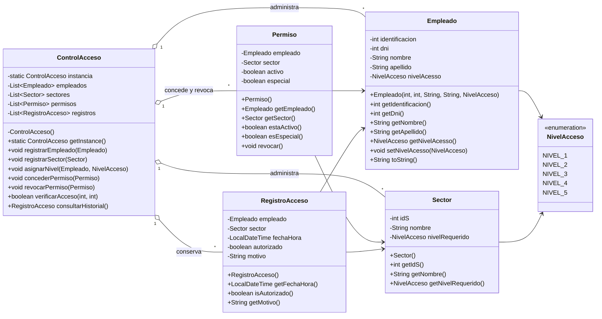
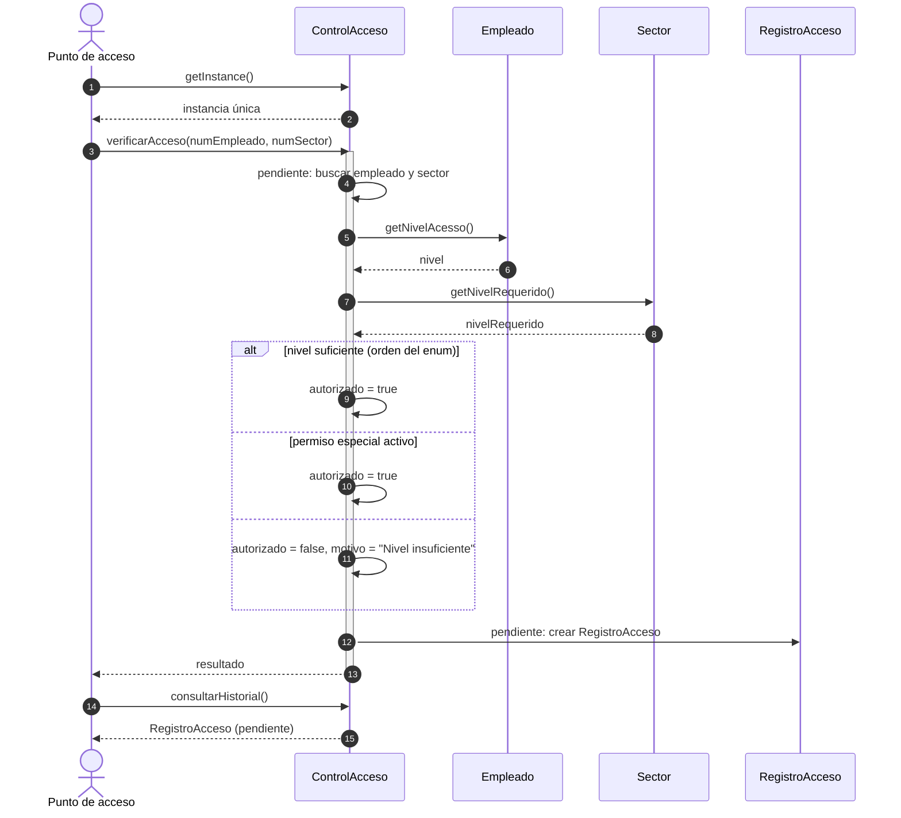

# 4. Diseño arquitectónico

> Este capítulo describe la **estructura implementada** en `src/` (rama `main`) y las
> decisiones de diseño que la acompañan. La lógica de negocio todavía no está
> implementada: la brecha exacta está en
> [Implementación §5.5](05-implementacion.md#55-brecha-entre-diseño-e-implementación).
> Las decisiones que no se aplicaron están marcadas en
> [Decisiones de diseño](09-decisiones.md).

## 4.1. Clases identificadas

| Componente | Rol en el sistema |
|------------|-------------------|
| `ControlAcceso` | Gestor central. Singleton. Fuente única de verdad. |
| `Empleado` | Persona que trabaja en la empresa y necesita identificarse. |
| `Sector` | Área del edificio con acceso restringido. |
| `Permiso` | Autorización que relaciona un empleado con un sector. |
| `RegistroAcceso` | Historial de los intentos de ingreso. |
| `NivelAcceso` | Enumeración con los cinco niveles (`NIVEL_1` a `NIVEL_5`). |
| `TipoPermiso` | **No existe**: el permiso especial se distingue con `Permiso.especial`. |

## 4.2. `ControlAcceso`

Clase principal del sistema, encargada de centralizar la lógica de seguridad y validación
bajo el patrón Singleton.

### Atributos

| Atributo | Tipo | Visibilidad | Descripción |
|----------|------|-------------|-------------|
| `instancia` | `ControlAcceso` | `private static` | Referencia a la única instancia de la clase. |
| `empleados` | `List<Empleado>` | `private` | Empleados registrados. |
| `sectores` | `List<Sector>` | `private` | Sectores disponibles. |
| `permisos` | `List<Permiso>` | `private` | Permisos concedidos (activos y revocados). |
| `registros` | `List<RegistroAcceso>` | `private` | Historial de accesos. |

> `permisos` se agrega al diseño original: sin esa colección, `ControlAcceso` no puede
> "conceder y revocar permisos" ni mantener una única fuente de verdad sobre ellos.
> Ver [ADR-05](09-decisiones.md#adr-05-los-permisos-viven-en-controlacceso).

### Responsabilidades

- Controlar la creación de la instancia única para evitar múltiples copias
  desincronizadas (patrón Singleton).
- Registrar empleados y sectores.
- Asignar niveles de acceso.
- Conceder y revocar permisos.
- Verificar los niveles de acceso de los empleados.
- Autorizar o rechazar los intentos de ingreso.
- Registrar los intentos de acceso.
- Consultar el historial de ingresos y rechazos.

### Interfaz pública

| Método | Resultado | Estado |
|--------|-----------|--------|
| `getInstance()` | Única instancia del gestor. | ✅ Implementado |
| `registrarEmpleado(Empleado)` | Alta en la colección de empleados. | ⚠️ Firma declarada, cuerpo pendiente |
| `registrarSector(Sector)` | Alta en la colección de sectores. | ⚠️ Firma declarada, cuerpo pendiente |
| `asignarNivel(Empleado, NivelAcceso)` | Actualiza el nivel del empleado. | ⚠️ Firma declarada, cuerpo pendiente |
| `concederPermiso(Permiso)` | Agrega la autorización a la colección. | ⚠️ Firma declarada, cuerpo pendiente |
| `revocarPermiso(Permiso)` | Delega la baja lógica en el permiso. | ⚠️ Firma declarada, cuerpo pendiente |
| `verificarAcceso(int, int)` | `true` si el empleado puede ingresar al sector. | ❌ Devuelve `false` fijo |
| `consultarHistorial()` | Devuelve el historial de registros. | ❌ Devuelve `null` |

> El **diseño previo** proponía además `buscarEmpleado(int)`, `buscarSector(int)`,
> `registrarIntento(Empleado, Sector)` y `obtenerHistorial()` como lista. Esos métodos
> **no existen en el código actual**; la brecha está registrada en
> [ADR-06](09-decisiones.md#adr-06-separar-verificar-de-registrar).

## 4.3. `Empleado`

Representa a cada persona que trabaja en la empresa y necesita identificarse para
ingresar a los sectores del edificio.

### Atributos

| Atributo | Tipo | Descripción |
|----------|------|-------------|
| `identificacion` | `private int` | Identificador único del empleado. |
| `dni` | `private int` | Número de identidad. |
| `nombre` | `private String` | Nombre. |
| `apellido` | `private String` | Apellido. |
| `nivelAcesso` | `private NivelAcceso` | Nivel de acceso asignado. |

### Responsabilidades

- Almacenar los datos del empleado.
- Proporcionar su identificación, nombre y apellido.
- Exponer y modificar el nivel de acceso que tiene asignado.

> El nivel se modela con el enum `NivelAcceso` y no con `int`, como pedía
> [ADR-01](09-decisiones.md#adr-01-nivelacceso-como-enum). El enum existe, pero todavía
> no encapsula la comparación acumulativa. El atributo del código se llama
> `nivelAcesso` (con una «c» de más); el nombre está pendiente de corregir o de aceptar
> formalmente.

## 4.4. `Sector`

Representa las diferentes áreas del edificio que tienen acceso restringido.

### Atributos

| Atributo | Tipo | Descripción |
|----------|------|-------------|
| `idS` | `private int` | Identificador único del sector. |
| `nombre` | `private String` | Nombre del sector. |
| `nivelRequerido` | `private NivelAcceso` | Nivel mínimo necesario para ingresar. |

### Responsabilidades

- Identificar cada sector.
- Proporcionar el nombre del área a la que se intenta ingresar.
- Establecer el nivel de acceso requerido para cada sector.

> El código conserva `idS`, el nombre del planteo original. El
> [ADR-04](09-decisiones.md#adr-04-identificacion-en-lugar-de-ids) proponía renombrarlo
> a `identificacion`; **esa decisión no se aplicó**. `Sector` tampoco tiene setters
> todavía.

## 4.5. `Permiso`

Representa la autorización que relaciona a un empleado con un sector determinado.

### Atributos

| Atributo | Tipo | Descripción |
|----------|------|-------------|
| `empleado` | `private Empleado` | Empleado al que pertenece la autorización. |
| `sector` | `private Sector` | Sector para el cual se concede el permiso. |
| `activo` | `private boolean` | `true` si está vigente; `false` si fue revocado. |
| `especial` | `private boolean` | `true` si es un permiso especial. |

### Responsabilidades

- Relacionar empleados con sectores.
- Registrar autorizaciones especiales.
- Permitir la revocación sin perder el dato histórico.
- Informar si la autorización está activa.

### Métodos propios

| Método | Resultado | Estado |
|--------|-----------|--------|
| `estaActivo()` | `true` si el permiso está vigente. | ✅ Implementado |
| `esEspecial()` | `true` si `especial` es verdadero. | ✅ Implementado |
| `revocar()` | Debería poner `activo = false`. | ⚠️ Declarado, cuerpo vacío |
| `activar()` | Reactivación de un permiso existente. | ❌ No existe |

> El [ADR-02](09-decisiones.md#adr-02-tipopermiso-como-enum) proponía un enum
> `TipoPermiso`; el código usa `boolean especial` y `TipoPermiso.java` no existe. La
> decisión está **no aplicada** y se revisa en el Anexo del documento de entrega.

## 4.6. `RegistroAcceso`

Almacena la información de cada intento de ingreso realizado por un empleado.

### Atributos

| Atributo | Tipo | Descripción |
|----------|------|-------------|
| `empleado` | `private Empleado` | Persona que intentó ingresar. |
| `sector` | `private Sector` | Sector al que intentó acceder. |
| `fechaHora` | `private LocalDateTime` | Fecha y hora del intento. |
| `autorizado` | `private boolean` | `true` si se permitió el ingreso. |
| `motivo` | `private String` | Explicación del rechazo; vacío o `null` si fue autorizado. |

### Responsabilidades

- Registrar qué empleado intentó acceder, a qué sector y en qué horario.
- Diferenciar los ingresos autorizados de los rechazados.
- Conservar información para consultar el historial de movimientos.

### Construcción

El diseño prevé crear el registro con `empleado`, `sector`, `autorizado` y `motivo`, y
que la **fecha y hora las asigne el propio registro** con `LocalDateTime.now()`, para que
un llamador no pueda falsear el momento del intento.

> El código actual tiene el constructor **vacío** y no asigna `fechaHora`; tampoco expone
> `getEmpleado()` ni `getSector()`. El tipo `LocalDateTime` sí está aplicado
> ([ADR-03](09-decisiones.md#adr-03-fechahora-como-localdatetime) parcial).

## 4.7. `NivelAcceso` (enumeración)

| Constante | Alcance |
|-----------|---------|
| `NIVEL_1` | Áreas comunes (acceso general). |
| `NIVEL_2` | Oficinas administrativas, Recursos Humanos (acceso interno). |
| `NIVEL_3` | Áreas con información sensible (acceso restringido). |
| `NIVEL_4` | Sala de servidores (acceso técnico). |
| `NIVEL_5` | Dirección (acceso directivo). |

El código actual del enum no guarda un valor numérico ni expone métodos:

```java
public enum NivelAcceso {
    NIVEL_1, // Acceso General
    NIVEL_2, // Acceso Interno
    NIVEL_3, // Acceso Restringido
    NIVEL_4, // Acceso Tecnico
    NIVEL_5  // Acceso Directivo
}
```

La comparación acumulativa se hará con el **orden de declaración**: `NIVEL_3` alcanza a
`NIVEL_1`, `NIVEL_2` y `NIVEL_3` porque su `ordinal()` es mayor o igual. Esa comparación
todavía no está encapsulada en el enum; el
[ADR-01](09-decisiones.md#adr-01-nivelacceso-como-enum) queda **parcialmente aplicado**.

## 4.8. `TipoPermiso` (no implementado)

El diseño proponía `enum TipoPermiso { ESTANDAR, ESPECIAL }`. El código **no tiene ese
archivo**: el permiso especial se representa con `Permiso.especial` (`boolean`). En
consecuencia, el [ADR-02](09-decisiones.md#adr-02-tipopermiso-como-enum) **no está
aplicado**. Las pruebas y el UML usan `boolean especial`, no el enum.

## 4.9. Relaciones y funcionamiento

- Un empleado tiene asignado **un nivel de acceso** y puede contar con **permisos
  especiales** para sectores determinados.
- Cada sector establece el **nivel mínimo** requerido.
- Cuando un empleado intenta ingresar, `ControlAcceso` deberá:
  1. comparar el `ordinal()` de `empleado.getNivelAcesso()` con el de
     `sector.getNivelRequerido()`;
  2. si no alcanza, buscar un permiso con `esEspecial() && estaActivo()` para ese par
     empleado–sector;
  3. autorizar o rechazar;
  4. registrar el intento con fecha/hora y, si rechaza, con el motivo.
- Los permisos se revocan **conservando su información** (`activo = false`), para mantener
  el registro de las autorizaciones concedidas.

> Los pasos 1 a 4 son el comportamiento **previsto**. En el código actual
> `verificarAcceso(int, int)` devuelve `false`, `revocar()` está vacío y no existe el
> método que registra el intento.

### Ejemplo

> Un empleado con nivel `NIVEL_2` puede ingresar a Administración y Recursos Humanos
> (`NIVEL_1` y `NIVEL_2`). No puede ingresar a la Sala de servidores (`NIVEL_4`) **salvo
> que tenga un permiso especial activo**.

## 4.10. Diagrama de clases



## 4.11. Aplicación del patrón Singleton

`ControlAcceso` implementa Singleton para garantizar que exista **una única instancia
administradora** dentro de la aplicación.

Así, los diferentes puntos de acceso consultan y modifican la misma información sobre
empleados, sectores, niveles y permisos, evitando que cada uno trabaje con datos
independientes o desactualizados.

Esta organización:

- separa las responsabilidades de las clases,
- centraliza las decisiones de autorización,
- facilita el mantenimiento y la ampliación del sistema.

## 4.12. Reglas de negocio del dominio

| ID | Regla | Estado en el código |
|----|-------|---------------------|
| RN-01 | Un empleado con nivel *n* puede ingresar a todo sector cuyo `nivelRequerido` sea `NIVEL_1` … `NIVEL_n`, según el orden de declaración del enum. | ❌ `verificarAcceso()` devuelve `false` fijo |
| RN-02 | Un permiso con `especial == true` y `activo == true` permite el ingreso aunque el nivel sea insuficiente. | ❌ Sin lógica de permisos |
| RN-03 | Un permiso revocado (`activo == false`) no habilita el ingreso y no se elimina. | ❌ `revocar()` está vacío |
| RN-04 | Todo intento se registra, sea autorizado o rechazado. | ❌ No hay método de registro |
| RN-05 | Todo rechazo debe registrar un `motivo`. | ❌ No hay método de registro |
| RN-06 | La revocación de un permiso es visible de inmediato para todos los sectores, porque existe una única instancia del gestor (patrón Singleton). | ✅ La instancia única existe; falta la operación |
| RN-07 | Solo se concede un permiso a un empleado y un sector que existan en el sistema. | ❌ Sin lógica de permisos |

> La numeración `RN-xx` es la que se usará en las tarjetas de implementación y en las
> pruebas. Si se adopta otra numeración, este documento y [Pruebas](06-pruebas.md) deben
> actualizarse juntos.

## 4.13. Decisiones de diseño adoptadas

Resumen; el detalle con contexto y consecuencias está en
[Decisiones de diseño (ADR)](09-decisiones.md).

| ADR | Decisión | Estado en el código |
|-----|----------|---------------------|
| ADR-01 | `NivelAcceso` como enum con valor numérico, en lugar de `int`. | ⚠️ Parcial: enum sin valor numérico ni comparación |
| ADR-02 | `TipoPermiso` como enum (`ESTANDAR`, `ESPECIAL`), en lugar de un `tipo` sin definir. | ❌ No aplicado: `boolean especial` |
| ADR-03 | `fechaHora` como `LocalDateTime`, en lugar de `String`. | ⚠️ Parcial: tipo correcto, sin asignación |
| ADR-04 | `Sector.identificacion` en lugar de `idS`. | ❌ No aplicado: sigue `idS` |
| ADR-05 | La colección `permisos` vive en `ControlAcceso`. | ✅ Aplicado |
| ADR-06 | Separar `verificarAcceso()` (consulta) de `registrarIntento()` (registro). | ❌ No aplicado: no existe `registrarIntento()` |
| ADR-07 | Singleton lazy sin `synchronized`, por claridad didáctica. | ✅ Aplicado |
| ADR-08 | Setters en todas las clases para cumplir `Reglas-Proyecto.md`. | ⚠️ Parcial: solo `Empleado` |

## 4.14. Flujo previsto de uso

1. `Main` obtiene el gestor: `ControlAcceso.getInstance()`.
2. Se registran empleados y sectores.
3. Se asignan niveles de acceso.
4. Se conceden (o revocan) permisos especiales.
5. Ocurre un intento de ingreso: empleado + sector.
6. El gestor valida nivel y permisos, y genera un `RegistroAcceso`.
7. Se consulta el historial para auditoría.



> Los pasos 2 a 7 dependen de código aún no implementado (ver
> [Implementación §5.5](05-implementacion.md#55-brecha-entre-diseño-e-implementación)).

---

[Volver al índice](../README.md) · [← Anterior: Marco teórico](03-marco-teorico.md) · [Siguiente: Implementación →](05-implementacion.md)
