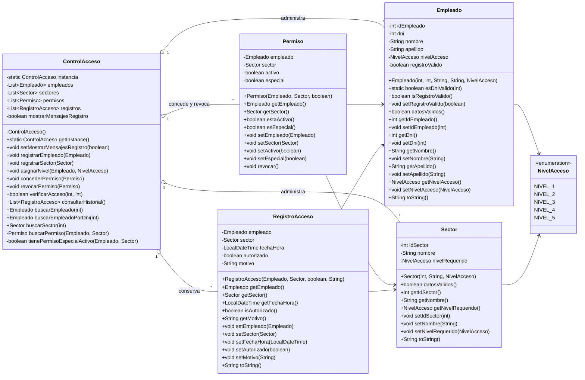
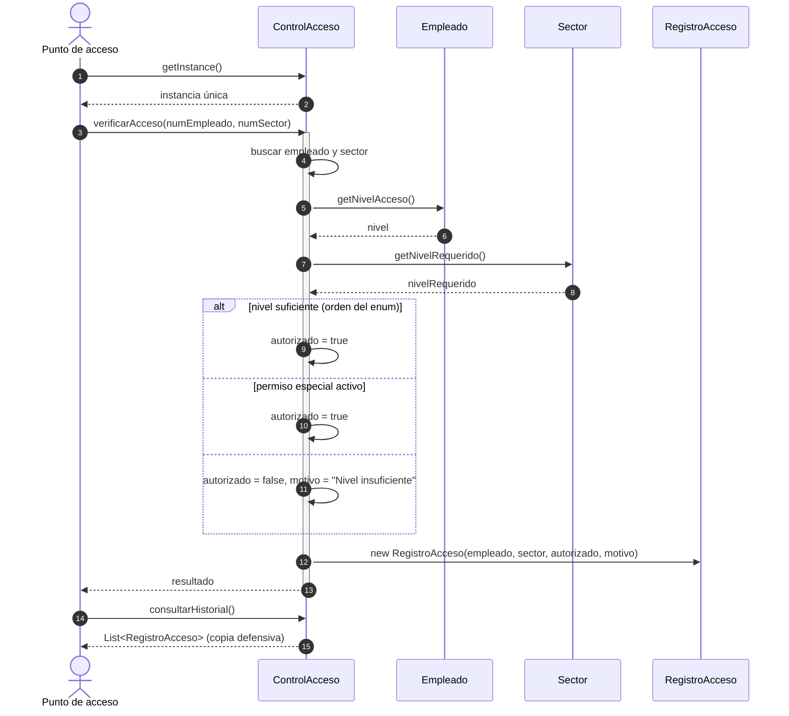

# 4. Diseño arquitectónico

> Este capítulo describe la **estructura implementada** en `src/` (rama `main`) y las
> decisiones de diseño que la acompañan. La lógica de negocio y métodos de soporte se
> encuentran implementados en el Singleton. La brecha histórica está en
> [Implementación §5.5](05-implementacion.md#55-brecha-entre-diseño-e-implementación).
> Las decisiones aplicadas y no aplicadas están detalladas en
> [Decisiones de diseño](09-decisiones.md).

## 4.1. Clases identificadas

| Componente | Rol en el sistema |
|------------|-------------------|
| `ControlAcceso` | Gestor central. Singleton. Fuente única de verdad. |
| `Empleado` | Persona que trabaja en la empresa y necesita identificarse. |
| `Sector` | Área del edificio con acceso restringido. |
| `Permiso` | Autorización que relaciona un empleado con un sector. |
| `RegistroAcceso` | Historial de los intentos de ingreso. |
| `NivelAcceso` | Enumeración con los cinco niveles (`NIVEL_1` a `NIVEL_5`). |
| `TipoPermiso` | **No existe**: el permiso especial se distingue con `Permiso.especial`. |

## 4.2. `ControlAcceso`

Clase principal del sistema, encargada de centralizar la lógica de seguridad y validación
bajo el patrón Singleton.

### Atributos

| Atributo | Tipo | Visibilidad | Descripción |
|----------|------|-------------|-------------|
| `instancia` | `ControlAcceso` | `private static` | Referencia a la única instancia de la clase. |
| `empleados` | `List<Empleado>` | `private` | Empleados registrados. |
| `sectores` | `List<Sector>` | `private` | Sectores disponibles. |
| `permisos` | `List<Permiso>` | `private` | Permisos concedidos (activos y revocados). |
| `registros` | `List<RegistroAcceso>` | `private` | Historial de accesos. |
| `mostrarMensajesRegistro` | `boolean` | `private` | Interruptor de los avisos de alta; permite silenciar la carga inicial. |

> `permisos` se agrega al diseño original: sin esa colección, `ControlAcceso` no puede
> "conceder y revocar permisos" ni mantener una única fuente de verdad sobre ellos.
> Ver [ADR-05](09-decisiones.md#adr-05-los-permisos-viven-en-controlacceso).

### Responsabilidades

- Controlar la creación de la instancia única para evitar múltiples copias
  desincronizadas (patrón Singleton).
- Registrar empleados y sectores.
- Asignar niveles de acceso.
- Conceder y revocar permisos.
- Verificar los niveles de acceso de los empleados.
- Autorizar o rechazar los intentos de ingreso.
- Registrar los intentos de acceso.
- Consultar el historial de ingresos y rechazos.

### Interfaz pública

| Método | Resultado | Estado |
|--------|-----------|--------|
| `getInstance()` | Única instancia del gestor. | ✅ Implementado |
| `registrarEmpleado(Empleado)` | Alta en la colección de empleados. | ✅ Implementado |
| `registrarSector(Sector)` | Alta en la colección de sectores. | ✅ Implementado |
| `asignarNivel(Empleado, NivelAcceso)` | Actualiza el nivel del empleado. | ✅ Implementado |
| `concederPermiso(Permiso)` | Agrega la autorización a la colección. | ✅ Implementado |
| `revocarPermiso(Permiso)` | Delega la baja lógica en el permiso. | ✅ Implementado |
| `verificarAcceso(int, int)` | `true` si el empleado puede ingresar al sector; genera registro. | ✅ Implementado |
| `consultarHistorial()` | Devuelve copia defensiva del historial (`List<RegistroAcceso>`). | ✅ Implementado |
| `setMostrarMensajesRegistro(boolean)` | Activa o silencia los avisos de alta. | ✅ Implementado |
| `getEmpleados()` / `getSectores()` / `getPermisos()` | Copias defensivas de cada colección. | ✅ Implementado |

> Como métodos auxiliares de validación y soporte interno se incorporaron `buscarEmpleado(int)`,
> `buscarEmpleadoPorDni(int)`, `buscarSector(int)`, `buscarPermiso(Empleado, Sector)` y
> `tienePermisoEspecialActivo(Empleado, Sector)`.

## 4.3. `Empleado`

Representa a cada persona que trabaja en la empresa y necesita identificarse para
ingresar a los sectores del edificio.

### Atributos

| Atributo | Tipo | Descripción |
|----------|------|-------------|
| `idEmpleado` | `private int` | Identificador único del empleado. |
| `dni` | `private int` | Número de identidad. |
| `nombre` | `private String` | Nombre. |
| `apellido` | `private String` | Apellido. |
| `nivelAcceso` | `private NivelAcceso` | Nivel de acceso asignado. |
| `registroValido` | `private boolean` | Indica si el empleado pasó las validaciones de alta. |

### Responsabilidades

- Almacenar los datos del empleado.
- Proporcionar su identificación, nombre y apellido.
- Exponer y modificar el nivel de acceso que tiene asignado.
- Validar el DNI (7 u 8 dígitos) y recalcular la validez de sus datos con `datosValidos()`.

> `isRegistroValido()` combina la marca `registroValido` con `datosValidos()`: si un setter
> deja los datos en un estado inválido, el empleado deja de considerarse registrable.
> `setRegistroValido(true)` no puede forzar la validez por sí solo
> ([ADR-09](09-decisiones.md#adr-09-clases-final-y-validez-calculada)).

> El nivel se modela con el enum `NivelAcceso` y no con `int`, como pedía
> [ADR-01](09-decisiones.md#adr-01-nivelacceso-como-enum). La comparación acumulativa
> compara el valor numérico de cada nivel mediante `alcanzaA()` (RN-01).

## 4.4. `Sector`

Representa las diferentes áreas del edificio que tienen acceso restringido.

### Atributos

| Atributo | Tipo | Descripción |
|----------|------|-------------|
| `idSector` | `private int` | Identificador único del sector. |
| `nombre` | `private String` | Nombre del sector. |
| `nivelRequerido` | `private NivelAcceso` | Nivel mínimo necesario para ingresar. |

### Responsabilidades

- Identificar cada sector.
- Proporcionar el nombre del área a la que se intenta ingresar.
- Establecer el nivel de acceso requerido para cada sector.
- Informar con `datosValidos()` si el sector tiene los datos mínimos para registrarse.

> `Sector` dispone de constructor parametrizado, getters y setters para todos sus campos;
> el constructor delega en los setters, de modo que valida con las mismas reglas. El
> identificador se llama `idSector`
> ([ADR-04](09-decisiones.md#adr-04-identificadores-idempleado--idsector) aplicado).

## 4.5. `Permiso`

Representa la autorización que relaciona a un empleado con un sector determinado.

### Atributos

| Atributo | Tipo | Descripción |
|----------|------|-------------|
| `empleado` | `private Empleado` | Empleado al que pertenece la autorización. |
| `sector` | `private Sector` | Sector para el cual se concede el permiso. |
| `activo` | `private boolean` | `true` si está vigente; `false` si fue revocado. |
| `especial` | `private boolean` | `true` si es un permiso especial. |

### Responsabilidades

- Relacionar empleados con sectores.
- Registrar autorizaciones especiales.
- Permitir la revocación sin perder el dato histórico.
- Informar si la autorización está activa.

### Métodos propios

| Método | Resultado | Estado |
|--------|-----------|--------|
| `estaActivo()` | `true` si el permiso está vigente. | ✅ Implementado |
| `esEspecial()` | `true` si `especial` es verdadero. | ✅ Implementado |
| `revocar()` | Pone `activo = false`. | ✅ Implementado |
| `setActivo(boolean)` | Permite reactivar un permiso existente. | ✅ Implementado |

> El [ADR-02](09-decisiones.md#adr-02-tipopermiso-como-enum) proponía un enum
> `TipoPermiso`; el código usa `boolean especial` y `TipoPermiso.java` no existe. La
> decisión está **no aplicada** y se revisa en el Anexo del documento de entrega.

## 4.6. `RegistroAcceso`

Almacena la información de cada intento de ingreso realizado por un empleado.

### Atributos

| Atributo | Tipo | Descripción |
|----------|------|-------------|
| `empleado` | `private Empleado` | Persona que intentó ingresar. |
| `sector` | `private Sector` | Sector al que intentó acceder. |
| `fechaHora` | `private LocalDateTime` | Fecha y hora del intento. |
| `autorizado` | `private boolean` | `true` si se permitió el ingreso. |
| `motivo` | `private String` | Explicación del rechazo; mensaje descriptivo si fue autorizado. |

### Responsabilidades

- Registrar qué empleado intentó acceder, a qué sector y en qué horario.
- Diferenciar los ingresos autorizados de los rechazados.
- Conservar información para consultar el historial de movimientos.
- Formatear la salida como texto legible mediante `toString()`.

### Construcción

El diseño crea el registro con `empleado`, `sector`, `autorizado` y `motivo`, y
la **fecha y hora las asigna el propio constructor** con `LocalDateTime.now()`, para que
un llamador no pueda falsear el momento del intento ([ADR-03](09-decisiones.md#adr-03-fechahora-como-localdatetime)).
Cuenta con getters y setters para todos sus campos y un método `toString()`.

## 4.7. `NivelAcceso` (enumeración)

| Constante | Alcance |
|-----------|---------|
| `NIVEL_1` | Áreas comunes (acceso general). |
| `NIVEL_2` | Oficinas administrativas, Recursos Humanos (acceso interno). |
| `NIVEL_3` | Áreas con información sensible (acceso restringido). |
| `NIVEL_4` | Sala de servidores (acceso técnico). |
| `NIVEL_5` | Dirección (acceso directivo). |

El código actual del enum:

```java
public enum NivelAcceso {
    NIVEL_1(1, "Acceso General"),
    NIVEL_2(2, "Acceso Interno"),
    NIVEL_3(3, "Acceso Restringido"),
    NIVEL_4(4, "Acceso Tecnico"),
    NIVEL_5(5, "Acceso Directivo");

    private final int nivel;
    private final String descripcion;

    private NivelAcceso(int nivel, String descripcion) {
        this.nivel = nivel;
        this.descripcion = descripcion;
    }

    public int getNivel() { return nivel; }
    public String getDescripcion() { return descripcion; }

    public boolean alcanzaA(NivelAcceso nivelRequerido) {
        if (nivelRequerido == null) {
            return false;
        }
        return this.nivel >= nivelRequerido.getNivel();
    }
}
```

La comparación acumulativa se hace con el **valor numérico** de cada nivel: `NIVEL_3`
alcanza a `NIVEL_1`, `NIVEL_2` y `NIVEL_3` porque `3 >= 1`, `3 >= 2` y `3 >= 3`.

## 4.8. `TipoPermiso` (no implementado)

El diseño proponía `enum TipoPermiso { ESTANDAR, ESPECIAL }`. El código **no tiene ese
archivo**: el permiso especial se representa con `Permiso.especial` (`boolean`). En
consecuencia, el [ADR-02](09-decisiones.md#adr-02-tipopermiso-como-enum) **no está
aplicado**. Las pruebas y el UML usan `boolean especial`, no el enum.

## 4.9. Relaciones y funcionamiento

- Un empleado tiene asignado **un nivel de acceso** y puede contar con **permisos
  especiales** para sectores determinados.
- Cada sector establece el **nivel mínimo** requerido.
- Cuando un empleado intenta ingresar, `ControlAcceso`:
  1. compara el nivel numérico de `empleado.getNivelAcceso()` con el del sector mediante `alcanzaA(sector.getNivelRequerido())`;
  2. si no alcanza, busca un permiso con `esEspecial() && estaActivo()` para ese par empleado–sector;
  3. autoriza o rechaza;
  4. registra el intento con fecha/hora actual y motivo explicativo.
- Los permisos se revocan **conservando su información** (`activo = false`), para mantener
  el registro de las autorizaciones concedidas.

### Ejemplo

> Un empleado con nivel `NIVEL_2` puede ingresar a Administración y Recursos Humanos
> (`NIVEL_1` y `NIVEL_2`). No puede ingresar a la Sala de servidores (`NIVEL_4`) **salvo
> que tenga un permiso especial activo**.

## 4.10. Diagrama de clases



> Las clases `ControlAcceso`, `Empleado`, `Sector`, `Permiso` y `RegistroAcceso` se
> declaran `final` ([ADR-09](09-decisiones.md#adr-09-clases-final-y-validez-calculada)).
> La fuente editable del UML de entrega es `assets/uml-clases.puml`.

## 4.11. Aplicación del patrón Singleton

`ControlAcceso` implementa Singleton para garantizar que exista **una única instancia
administradora** dentro de la aplicación.

Así, los diferentes puntos de acceso consultan y modifican la misma información sobre
empleados, sectores, niveles y permisos, evitando que cada uno trabaje con datos
independientes o desactualizados.

Esta organización:

- separa las responsabilidades de las clases,
- centraliza las decisiones de autorización,
- facilita el mantenimiento y la ampliación del sistema.

## 4.12. Reglas de negocio del dominio

| ID | Regla | Estado en el código |
|----|-------|---------------------|
| RN-01 | Un empleado con nivel *n* puede ingresar a todo sector cuyo `nivelRequerido` sea `NIVEL_1` … `NIVEL_n`, según el valor numérico del enum. | ✅ Implementado vía `getNivel()` |
| RN-02 | Un permiso con `especial == true` y `activo == true` permite el ingreso aunque el nivel sea insuficiente. | ✅ Implementado en `tienePermisoEspecialActivo()` |
| RN-03 | Un permiso revocado (`activo == false`) no habilita el ingreso y no se elimina. | ✅ Implementado en `revocarPermiso()` y `Permiso.revocar()` |
| RN-04 | Todo intento se registra, sea autorizado o rechazado. | ✅ Implementado en `verificarAcceso()` |
| RN-05 | Todo rechazo debe registrar un `motivo`. | ✅ Implementado con motivos descriptivos |
| RN-06 | La revocación de un permiso es visible de inmediato para todos los sectores, porque existe una única instancia del gestor (patrón Singleton). | ✅ Garantizado por Singleton |
| RN-07 | Solo se concede un permiso a un empleado y un sector que existan en el sistema. | ✅ Validado en `concederPermiso()` |

> La numeración `RN-xx` es la que se usará en las tarjetas de implementación y en las
> pruebas. Si se adopta otra numeración, este documento y [Pruebas](06-pruebas.md) deben
> actualizarse juntos.

## 4.13. Decisiones de diseño adoptadas

Resumen; el detalle con contexto y consecuencias está en
[Decisiones de diseño (ADR)](09-decisiones.md).

| ADR | Decisión | Estado en el código |
|-----|----------|---------------------|
| ADR-01 | `NivelAcceso` como enum con valor numérico, en lugar de `int`. | ✅ Aplicado: `alcanzaA()` compara por `getNivel()` |
| ADR-02 | `TipoPermiso` como enum (`ESTANDAR`, `ESPECIAL`), en lugar de un `tipo` sin definir. | ❌ No aplicado: `boolean especial` |
| ADR-03 | `fechaHora` como `LocalDateTime`, en lugar de `String`. | ✅ Aplicado: asignación con `LocalDateTime.now()` en constructor |
| ADR-04 | `idEmpleado` / `idSector` en lugar de `idS`. | ✅ Aplicado: atributos, getters y setters renombrados |
| ADR-05 | La colección `permisos` vive en `ControlAcceso`. | ✅ Aplicado |
| ADR-06 | Separar `verificarAcceso()` (consulta) de `registrarIntento()` (registro). | ❌ No aplicado: `verificarAcceso` realiza la verificación y el registro |
| ADR-07 | Singleton lazy sin `synchronized`, por claridad didáctica. | ✅ Aplicado |
| ADR-08 | Setters en todas las clases para cumplir `Reglas-Proyecto.md`. | ✅ Aplicado: constructores, getters y setters en todas las entidades |
| ADR-09 | Clases de dominio `final` y validez calculada en `Empleado`. | ✅ Aplicado: las cinco clases son `final`; `datosValidos()` y `setRegistroValido()` evitan estados inválidos |

## 4.14. Flujo previsto de uso

1. `Main` obtiene el gestor: `ControlAcceso.getInstance()`.
2. Se registran empleados y sectores.
3. Se asignan niveles de acceso.
4. Se conceden (o revocan) permisos especiales.
5. Ocurre un intento de ingreso: empleado + sector.
6. El gestor valida nivel y permisos, y genera un `RegistroAcceso`.
7. Se consulta el historial para auditoría.



> La secuencia muestra el flujo implementado en `ControlAcceso`.

---

[Volver al índice](../README.md) · [← Anterior: Marco teórico](03-marco-teorico.md) · [Siguiente: Implementación →](05-implementacion.md)
