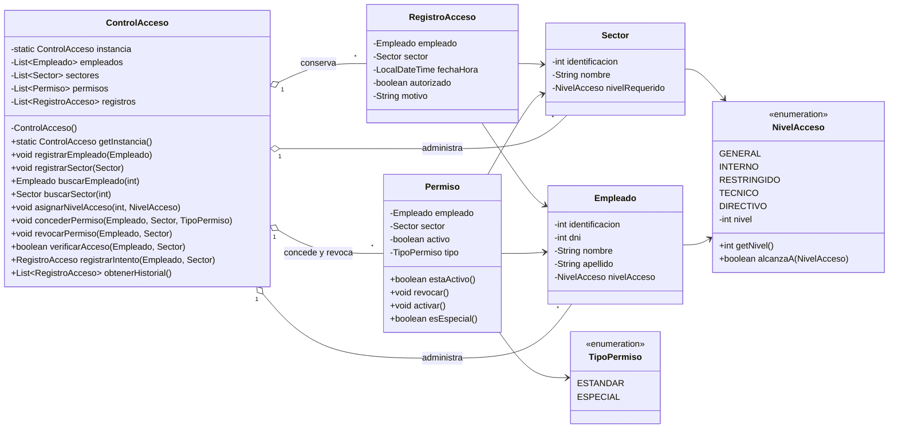
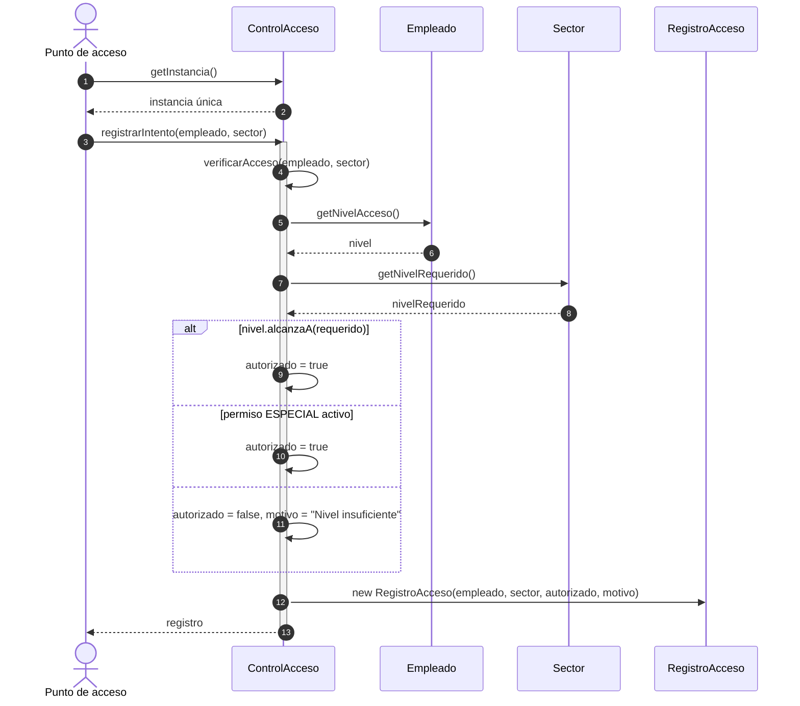

# 4. Diseño arquitectónico

> Este capítulo define el **diseño cerrado**. El código todavía no lo implementa en su
> totalidad: la brecha exacta está en [Implementación §5.5](05-implementacion.md#55-brecha-entre-diseño-e-implementación).
> Las decisiones que modifican el planteo original están justificadas en
> [Decisiones de diseño](09-decisiones.md).

## 4.1. Clases identificadas

| Componente | Rol en el sistema |
|------------|-------------------|
| `ControlAcceso` | Gestor central. Singleton. Fuente única de verdad. |
| `Empleado` | Persona que trabaja en la empresa y necesita identificarse. |
| `Sector` | Área del edificio con acceso restringido. |
| `Permiso` | Autorización que relaciona un empleado con un sector. |
| `RegistroAcceso` | Historial de los intentos de ingreso. |
| `NivelAcceso` | Enumeración con los cinco niveles de seguridad (1 a 5). |
| `TipoPermiso` | Enumeración que distingue permiso estándar de especial. |

## 4.2. `ControlAcceso`

Clase principal del sistema, encargada de centralizar la lógica de seguridad y validación
bajo el patrón Singleton.

### Atributos

| Atributo | Tipo | Visibilidad | Descripción |
|----------|------|-------------|-------------|
| `instancia` | `ControlAcceso` | `private static` | Referencia a la única instancia de la clase. |
| `empleados` | `List<Empleado>` | `private` | Empleados registrados. |
| `sectores` | `List<Sector>` | `private` | Sectores disponibles. |
| `permisos` | `List<Permiso>` | `private` | Permisos concedidos (activos y revocados). |
| `registros` | `List<RegistroAcceso>` | `private` | Historial de accesos. |

> `permisos` se agrega al diseño original: sin esa colección, `ControlAcceso` no puede
> "conceder y revocar permisos" ni mantener una única fuente de verdad sobre ellos.
> Ver [ADR-05](09-decisiones.md#adr-05-los-permisos-viven-en-controlacceso).

### Responsabilidades

- Controlar la creación de la instancia única para evitar múltiples copias
  desincronizadas (patrón Singleton).
- Registrar empleados y sectores.
- Asignar niveles de acceso.
- Conceder y revocar permisos.
- Verificar los niveles de acceso de los empleados.
- Autorizar o rechazar los intentos de ingreso.
- Registrar los intentos de acceso.
- Consultar el historial de ingresos y rechazos.

### Interfaz pública

| Método | Resultado |
|--------|-----------|
| `getInstancia()` | Única instancia del gestor. |
| `registrarEmpleado(Empleado)` | Alta en la colección de empleados. |
| `registrarSector(Sector)` | Alta en la colección de sectores. |
| `buscarEmpleado(int)` | Empleado por identificación, o `null`. |
| `buscarSector(int)` | Sector por identificación, o `null`. |
| `asignarNivelAcceso(int, NivelAcceso)` | Actualiza el nivel del empleado. |
| `concederPermiso(Empleado, Sector, TipoPermiso)` | Crea o reactiva un permiso. |
| `revocarPermiso(Empleado, Sector)` | Marca el permiso como inactivo (no lo borra). |
| `verificarAcceso(Empleado, Sector)` | `true` si puede ingresar. **No registra.** |
| `registrarIntento(Empleado, Sector)` | Verifica, arma el motivo, guarda y devuelve el `RegistroAcceso`. |
| `obtenerHistorial()` | Copia de la lista de registros. |

La separación entre **verificar** y **registrar** está justificada en
[ADR-06](09-decisiones.md#adr-06-separar-verificar-de-registrar).

## 4.3. `Empleado`

Representa a cada persona que trabaja en la empresa y necesita identificarse para
ingresar a los sectores del edificio.

### Atributos

| Atributo | Tipo | Descripción |
|----------|------|-------------|
| `identificacion` | `private int` | Identificador único del empleado. |
| `dni` | `private int` | Número de identidad. |
| `nombre` | `private String` | Nombre. |
| `apellido` | `private String` | Apellido. |
| `nivelAcceso` | `private NivelAcceso` | Nivel de acceso asignado. |

### Responsabilidades

- Almacenar los datos del empleado.
- Proporcionar su identificación, nombre y apellido.
- Exponer el nivel de acceso que tiene asignado.

> El nivel se modela con el enum `NivelAcceso` y no con `int`. Ver
> [ADR-01](09-decisiones.md#adr-01-nivelacceso-como-enum).

## 4.4. `Sector`

Representa las diferentes áreas del edificio que tienen acceso restringido.

### Atributos

| Atributo | Tipo | Descripción |
|----------|------|-------------|
| `identificacion` | `private int` | Identificador único del sector. |
| `nombre` | `private String` | Nombre del sector. |
| `nivelRequerido` | `private NivelAcceso` | Nivel mínimo necesario para ingresar. |

### Responsabilidades

- Identificar cada sector.
- Proporcionar el nombre del área a la que se intenta ingresar.
- Establecer el nivel de acceso requerido para cada sector.

> El atributo `idS` del planteo original se renombra a `identificacion` para respetar la
> convención de nombres del proyecto. Ver [ADR-04](09-decisiones.md#adr-04-identificacion-en-lugar-de-ids).

## 4.5. `Permiso`

Representa la autorización que relaciona a un empleado con un sector determinado.

### Atributos

| Atributo | Tipo | Descripción |
|----------|------|-------------|
| `empleado` | `private Empleado` | Empleado al que pertenece la autorización. |
| `sector` | `private Sector` | Sector para el cual se concede el permiso. |
| `activo` | `private boolean` | `true` si está vigente; `false` si fue revocado. |
| `tipo` | `private TipoPermiso` | `ESTANDAR` o `ESPECIAL`. |

### Responsabilidades

- Relacionar empleados con sectores.
- Registrar autorizaciones especiales.
- Permitir la revocación sin perder el dato histórico.
- Informar si la autorización está activa.

### Métodos propios

| Método | Resultado |
|--------|-----------|
| `estaActivo()` | `true` si el permiso está vigente. |
| `revocar()` | `activo = false`. |
| `activar()` | `activo = true` (reactivación de un permiso existente). |
| `esEspecial()` | `tipo == TipoPermiso.ESPECIAL`. |

> `tipo` no tenía tipo declarado en el planteo; se resuelve con el enum `TipoPermiso`.
> Ver [ADR-02](09-decisiones.md#adr-02-tipopermiso-como-enum).

## 4.6. `RegistroAcceso`

Almacena la información de cada intento de ingreso realizado por un empleado.

### Atributos

| Atributo | Tipo | Descripción |
|----------|------|-------------|
| `empleado` | `private Empleado` | Persona que intentó ingresar. |
| `sector` | `private Sector` | Sector al que intentó acceder. |
| `fechaHora` | `private LocalDateTime` | Fecha y hora del intento. |
| `autorizado` | `private boolean` | `true` si se permitió el ingreso. |
| `motivo` | `private String` | Explicación del rechazo; vacío o `null` si fue autorizado. |

### Responsabilidades

- Registrar qué empleado intentó acceder, a qué sector y en qué horario.
- Diferenciar los ingresos autorizados de los rechazados.
- Conservar información para consultar el historial de movimientos.

### Construcción

El registro se crea con `empleado`, `sector`, `autorizado` y `motivo`; la **fecha y hora
la asigna el propio registro** con `LocalDateTime.now()`, para que un llamador no pueda
falsear el momento del intento.

> `fechaHora` era `String` en el planteo; se cambia a `LocalDateTime` para poder ordenar
> y filtrar el historial. Ver [ADR-03](09-decisiones.md#adr-03-fechahora-como-localdatetime).

## 4.7. `NivelAcceso` (enumeración)

| Constante | Valor | Alcance |
|-----------|-------|---------|
| `GENERAL` | 1 | Áreas comunes. |
| `INTERNO` | 2 | Oficinas administrativas, Recursos Humanos. |
| `RESTRINGIDO` | 3 | Áreas con información sensible. |
| `TECNICO` | 4 | Sala de servidores. |
| `DIRECTIVO` | 5 | Dirección. |

El enum encapsula el valor numérico y la comparación acumulativa:

```java
public enum NivelAcceso {
    GENERAL(1), INTERNO(2), RESTRINGIDO(3), TECNICO(4), DIRECTIVO(5);

    private final int nivel;

    NivelAcceso(int nivel) {
        this.nivel = nivel;
    }

    public int getNivel() {
        return nivel;
    }

    public boolean alcanzaA(NivelAcceso requerido) {
        return this.nivel >= requerido.nivel;
    }
}
```

Consecuencia: un empleado con `RESTRINGIDO` (3) alcanza a los sectores que requieren
`GENERAL`, `INTERNO` y `RESTRINGIDO`.

## 4.8. `TipoPermiso` (enumeración)

| Constante | Significado |
|-----------|-------------|
| `ESTANDAR` | Autorización ordinaria. |
| `ESPECIAL` | Autorización que habilita el ingreso aunque el nivel sea insuficiente. |

## 4.9. Relaciones y funcionamiento

- Un empleado tiene asignado **un nivel de acceso** y puede contar con **permisos
  especiales** para sectores determinados.
- Cada sector establece el **nivel mínimo** requerido.
- Cuando un empleado intenta ingresar, `ControlAcceso`:
  1. compara `empleado.getNivelAcceso().alcanzaA(sector.getNivelRequerido())`;
  2. si no alcanza, busca un permiso `ESPECIAL` **activo** para ese par empleado–sector;
  3. autoriza o rechaza;
  4. registra el intento con fecha/hora y, si rechaza, con el motivo.
- Los permisos se revocan **conservando su información** (`activo = false`), para mantener
  el registro de las autorizaciones concedidas.

### Ejemplo

> Un empleado con nivel `INTERNO` (2) puede ingresar a Administración y Recursos Humanos
> (niveles 1 y 2). No puede ingresar a la Sala de servidores (nivel 4) **salvo que tenga
> un permiso especial activo**.

## 4.10. Diagrama de clases



## 4.11. Aplicación del patrón Singleton

`ControlAcceso` implementa Singleton para garantizar que exista **una única instancia
administradora** dentro de la aplicación.

Así, los diferentes puntos de acceso consultan y modifican la misma información sobre
empleados, sectores, niveles y permisos, evitando que cada uno trabaje con datos
independientes o desactualizados.

Esta organización:

- separa las responsabilidades de las clases,
- centraliza las decisiones de autorización,
- facilita el mantenimiento y la ampliación del sistema.

## 4.12. Reglas de negocio del dominio

| ID | Regla |
|----|-------|
| RN-01 | Un empleado con nivel *N* puede ingresar a todo sector cuyo `nivelRequerido <= N`. |
| RN-02 | Un permiso `ESPECIAL` **activo** permite el ingreso aunque el nivel sea insuficiente. |
| RN-03 | Un permiso revocado (`activo == false`) no habilita el ingreso y no se elimina. |
| RN-04 | Todo intento se registra, sea autorizado o rechazado. |
| RN-05 | Todo rechazo debe registrar un `motivo`. |
| RN-06 | La revocación de un permiso es visible de inmediato para todos los sectores, porque existe una única instancia del gestor (patrón Singleton). |
| RN-07 | Solo se concede un permiso a un empleado y un sector que existan en el sistema. |

> La numeración `RN-xx` es la que se usará en las tarjetas de implementación y en las
> pruebas. Si se adopta otra numeración, este documento y [Pruebas](06-pruebas.md) deben
> actualizarse juntos.

## 4.13. Decisiones de diseño adoptadas

Resumen; el detalle con contexto y consecuencias está en
[Decisiones de diseño (ADR)](09-decisiones.md).

| ADR | Decisión |
|-----|----------|
| ADR-01 | `NivelAcceso` como enum con valor numérico, en lugar de `int`. |
| ADR-02 | `TipoPermiso` como enum (`ESTANDAR`, `ESPECIAL`), en lugar de un `tipo` sin definir. |
| ADR-03 | `fechaHora` como `LocalDateTime`, en lugar de `String`. |
| ADR-04 | `Sector.identificacion` en lugar de `idS`. |
| ADR-05 | La colección `permisos` vive en `ControlAcceso`. |
| ADR-06 | Separar `verificarAcceso()` (consulta) de `registrarIntento()` (registro). |
| ADR-07 | Singleton lazy sin `synchronized`, por claridad didáctica. |
| ADR-08 | Setters en todas las clases para cumplir `Reglas-Proyecto.md`. |

## 4.14. Flujo previsto de uso

1. `Main` obtiene el gestor: `ControlAcceso.getInstancia()`.
2. Se registran empleados y sectores.
3. Se asignan niveles de acceso.
4. Se conceden (o revocan) permisos especiales.
5. Ocurre un intento de ingreso: empleado + sector.
6. El gestor valida nivel y permisos, y genera un `RegistroAcceso`.
7. Se consulta el historial para auditoría.



> Los pasos 2 a 7 dependen de código aún no implementado (ver
> [Implementación §5.5](05-implementacion.md#55-brecha-entre-diseño-e-implementación)).

---

[Volver al índice](../README.md) · [← Anterior: Marco teórico](03-marco-teorico.md) · [Siguiente: Implementación →](05-implementacion.md)
